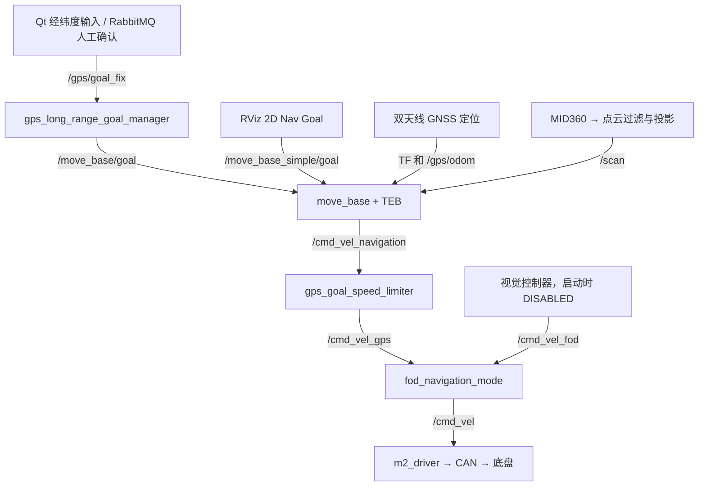

# Agent 上手：双天线 GNSS 完整导航

Jetson 本机迁移后的启动命令与环境见 [AGX_STARTUP.md](AGX_STARTUP.md)，实际验证结果见 [AGX_MIGRATION_REPORT.md](AGX_MIGRATION_REPORT.md)。

速度配置更新日期：2026-09-29。工作区：`/home/slam/robot_ws_agx`；ROS Noetic / catkin；车辆：Autolabor M2 阿克曼底盘。当前相机回收操作与完整配置以 [AGX_STARTUP.md](AGX_STARTUP.md) 为准。

本文面向第一次接手此仓库的 agent 和操作员，依据当前工作区脚本、launch、配置与源码整理。范围是双天线 GNSS 定位导航及现有完整操作台，不展开 FAST_LIO 定位模式。

## 1. 先读这几条，再执行

1. 先读 [AGENTS.md](AGENTS.md) 和 [DEVELOPMENT_CONSTRAINTS.md](DEVELOPMENT_CONSTRAINTS.md)。本地项目规则以用户最新明确需求为最高优先级，以启动完整导航和实现用户指定运行方式为优先目标；用户明确要求删除、关闭、调整或绕过已有检查和保护时按要求实施。原 GNSS 导航已由用户反复测试验收，用户未要求改变的入口、顺序、参数语义和控制链默认保持兼容。历史交接中的旧待验收事项不能变成新的启动步骤或运动许可条件。
2. 在工作区运行 `git status --short --branch`。本次接手时实际分支为 `gnss_0913_lianxinag`，HEAD 为 `eb2353ad`，已有多处未提交改动及脏子模块。使用当前工作区，不因 AGENTS 中写着主分支 `main` 就切分支、拉取覆盖、reset 或清理用户文件。
3. 已有 `devel/setup.bash` 和可执行文件时直接使用。日常启动不用重新编译、跑全量测试或录包。
4. 无设备查看界面用 `operator_gui.sh`；“启动完整导航”使用下节的一体化入口；“仅启动 GNSS 导航”使用 `bringup.sh gps`。**不要省略 `gps`**：`bringup.sh` 无参数默认进入另一个定位模式。
5. 只要求启动时，启动后等待操作员下发目标。前方 8 m、随机目标、视觉回收和清扫开关都会操作实车，属于额外作业。

背景材料：[实操指南](Autolabor-M2实操实验记录.md)、[历史交接](CURRENT_GPS_DEV_HANDOFF.md)。历史中的启动先后、速度、地图尺寸、目标路由可能已过时；当前 `bringup.sh` 的参数传递和实际加载的文件是核对运行行为的依据。

## 2. 最常用的启动命令

### 无设备上手：只打开操作台

```bash
cd /home/slam/robot_ws_agx
./scripts/operator_gui.sh
```

这适用于用户当前未接任何设备、只需熟悉界面的场景。脚本自动加载 ROS 环境，`roslaunch` 在没有 ROS master 时启动 master，随后打开 Qt（含内嵌 RViz）和默认静态误差监视器。导航、传感器和远程目标会显示离线/等待数据；缺少 `camera_init` 的 RViz 状态提示也是此场景的预期状态。

该入口不启动 CAN、GNSS、雷达、相机、YOLO 或 RabbitMQ。关闭 Qt 或在主终端按 `Ctrl+C` 结束。以后需要导航时，退出这个独立操作台再使用下面的完整入口，避免重复启动同名 Qt 节点。

### 完整系统：双天线 GNSS + Qt + 相机识别 + RabbitMQ

在本机图形桌面的终端执行，并保持此终端运行：

```bash
cd /home/slam/robot_ws_agx
./scripts/operator_all_in_one.sh 1.6 cruise
```

`1.6` 是前进规划速度上限，单位 m/s；`cruise` 是开阔道路配置。这也是一体化入口不传参数时的现有默认值。用户指定速度或场景时使用其指定值，例如 `./scripts/operator_all_in_one.sh 0.5 cruise`；参数不是要求车立即以此速度行驶。

该入口的当前行为是：

1. 创建或复用 ROS master。
2. 后台启动 `TERMINAL_MODE=same NAV_START_RVIZ=false ./scripts/bringup.sh gps <速度> <场景>`。
3. 随后启动海康相机、YOLO11、图像质量控制器、RabbitMQ 桥和 Qt；这些模块与导航初始化并行。Qt 内嵌 RViz，因此没有第二个独立 RViz。
4. 后台等待本次 `bringup.log` 中的完成标志：

   ```text
   Robot bringup is running in gps mode.
   ```

5. 如果 GNSS 导航在就绪前退出，Qt 继续显示离线诊断。**窗口出现、ROS master 存在或 ROS topic 名称出现，都不能单独作为完整导航启动成功的依据。**

主终端打印本次日志目录 `log/operator_all_in_one_YYYYMMDD_HHMMSS/`，按实际启动模块生成 `bringup.log`、`gui.log`、`vision.log`、`rabbitmq.log` 和 `fallback_roscore.log`。判断这次启动要查看这次目录，不能用旧日志的成功标志。

关闭 Qt 或在主终端按 `Ctrl+C` 会结束该入口启动的进程。导航因缺设备退出后，连接好设备再关闭旧入口并重新运行；保留的降级窗口不会自动重新执行已经退出的 `bringup.sh`。

### 仅 GNSS 导航与独立 RViz

```bash
cd /home/slam/robot_ws_agx
./scripts/bringup.sh gps 1.6 cruise
```

两个入口的默认速度均为 1.6 m/s：

| 入口 | 不指定速度时 | 默认显示方式 |
| --- | --- | --- |
| `./scripts/bringup.sh gps` | `1.6 m/s`，`cruise` | 独立 RViz |
| `./scripts/operator_all_in_one.sh` | `1.6 m/s`，`cruise` | Qt 内嵌 RViz |

`cruise` 面向开阔道路、长直段；`obstacle` 面向密集静态障碍。实际前进/倒车上限还受底盘上报的 `max_speed` 约束；倒车配置默认跟随前进默认值，当前为 `1.6 m/s`。显式设置 `GPS_NAV_MAX_VEL_X_BACKWARDS` 可保留较低倒车上限，位置参数仍会将其限制在所请求的速度以内。`cruise` 的纵向/转向规划加速度为 `3.0 m/s²` / `1.2 rad/s²`，两个场景均允许倒车初始化并降低前进偏好。

导航已运行，仅需添加操作台时，另开终端运行 `./scripts/operator_gui.sh`。该脚本只启动 Qt 和默认 GPS 静态误差监视器，不重复启动导航。独立组合可预先用 `NAV_START_RVIZ=false ./scripts/bringup.sh gps 1.6 cruise` 避免两个 RViz。

不要同时运行两个导航入口。`bringup.sh` 的现有 `CLEAN_START=true` 会清理其管理的旧导航节点，重复启动会影响正在运行的会话。

## 3. 环境与设备对应关系

`.sh` 入口自行加载 ROS 环境。另开终端运行 `rosnode`、`rostopic`、`rosparam`、`roslaunch` 或 ROS Python 程序时先执行：

```bash
cd /home/slam/robot_ws_agx
source /opt/ros/noetic/setup.bash
source devel/setup.bash
```

| 设备/环境 | 当前配置 | 配置来源或覆盖方法 |
| --- | --- | --- |
| CAN 串口转接器 | 通用默认 `/dev/ttyUSB0`，本机实际映射见下文 | `CAN_PORT` |
| 双天线 GNSS 接收机 | 通用默认 `/dev/ttyUSB1`，115200；本机实际映射见下文 | `GPS_PORT`、`GPS_BAUD_RATE` |
| Livox MID360 | 本机实测雷达 `192.168.1.112`；主机接收地址 `192.168.1.50` | [MID360_config.json](src/perception_livox/livox_ros_driver2/config/MID360_config.json)；迁移包原值为 `.125` |
| 海康 USB 相机 | 序列号 `DA7535899` | [视觉 launch](src/application/autolabor_fod_vision/launch/hikrobot_fod_detection.launch) |
| YOLO Python | `/home/slam/python_env/fod_yolo/bin/python3` | `OPERATOR_DETECTOR_PYTHON` |
| FOD 专用模型 | `src/yolo/fod_yolo11n_img640_e300_orig/weights/best.pt` | 同上视觉 launch；不替换成通用 COCO 模型 |
| Qt 桌面 | 使用当前用户有效的 `DISPLAY` / `XAUTHORITY` | 在实际桌面会话启动 |

USB 插拔后编号可能变化，应根据实际设备身份映射 CAN 和 GNSS。已有入口支持覆盖。

本 Jetson 在 2026-09-28 已确认 CAN 为 `B400CG51`（当时 `ttyUSB1`），GNSS 为
`FTENXGO4`（当时 `ttyUSB0`）；请使用 [AGX_STARTUP.md](AGX_STARTUP.md)
中的固定设备路径命令。下例仅演示通用默认编号，不能直接代表本次实际接线。

```bash
CAN_PORT=/dev/ttyUSB0 GPS_PORT=/dev/ttyUSB1 GPS_BAUD_RATE=115200 \
  ./scripts/operator_all_in_one.sh 1.6 cruise
```

GNSS 的同一个串口流同时提供 GGA/RMC 经纬度和 `#UNIHEADINGA` 双天线航向。接收机应已有正确的输出配置，项目启动脚本负责读取；日常启动无需手输车头方向。运行期间不要用另一个串口读取程序争用该端口。

MID360 的主机地址必须实际配置在连接雷达的网卡上。设备未出现、网线未连接或主机没有配置接收地址时，先恢复设备连接与既有网络配置。海康 ROS 驱动使用相机时，关闭会独占该相机的 `hikrobot-mvs` 客户端。

## 4. GNSS 导航实际启动顺序

以下是 `scripts/bringup.sh gps` 已有顺序的说明，不需要人工逐个执行，也不要在其外面再包装一层就绪检查。

| 顺序 | 当前入口/节点 | 这一阶段完成什么 |
| --- | --- | --- |
| 1 | ROS 环境、旧节点清理、ROS master | 准备同一 ROS 图 |
| 2 | `robot_bringup/can.launch` → `/canbus_driver`、`/m2_driver` | 检查 CAN 设备、启动底盘，等待 `/canbus_msg`，读取 `/m2_driver/chassis_parameter` 的速度上限；底盘 `publish_tf=false` |
| 3 | `livox_mid360.launch` | 检查 GNSS 设备路径后启动 MID360，等待 `/livox/lidar`、`/livox/imu` |
| 4 | `fast_lio.launch odom_pub_en:=false tf_pub_en:=false` → `/laserMapping` | 处理避障点云，等待 `/cloud_registered_body` |
| 5 | `scan_fast_lio.launch` | 自车过滤、点云投影到 `/scan`；发布 `base_link → body` 静态 TF，z 为 `+0.6 m` |
| 6 | `gps_localization.launch` → `/gps_localization` | 等待底盘 `/odom` 后，读取 GNSS 位置和双天线航向，生成 `/gps/odom` 和 `camera_init → base_link` |
| 7 | `gps_long_range_goal.launch` | 启动最终 GPS 目标到滚动 action 子目标的转换 |
| 8 | `gps_visual_recovery_standby.launch` | 启动现有 GPS/FOD 模式管理器和处于 `DISABLED` 的视觉控制器；初始导航模式为 `GPS_ACTIVE` |
| 9 | `navigation_arena.launch localization_source:=gps` | 加载 `dingo` 底盘配置、选定的 TEB 场景覆盖、目标指令中继，启动 `move_base` |
| 10 | 原有 topic、TF、目标与速度路由检查 | 最终打印 `Robot bringup is running in gps mode.` |

**此模式仍会出现 `/laserMapping` 进程，因为它提供避障点云。** 其定位里程计和 TF 输出已由入口关闭；车辆定位来自 GNSS。不要因为暂时不使用 FAST_LIO 定位，就删除该点云环节、等待 `/Odometry`，或改成双定位 TF 同时发布。

FAST_LIO 进程的系统 libusb 路径由启动脚本单独处理，保留此环境隔离即可；无需修改海康 SDK 的全局库设置。

## 5. 双天线定位、坐标系与速度反馈

| 项目 | 当前 GNSS 行为 |
| --- | --- |
| 位置 | 读取有效 GGA/RMC；位置默认 10 Hz 发布，串口连续读取，不在每条语句后 sleep |
| 航向 | `GPS_HEADING_SOURCE=dual_antenna`；读取有效 `UNIHEADINGA` |
| 航向质量 | `SOL_COMPUTED + NARROW_INT`，有效期 `1.0 s`；启动等待 `/gps/odom` 最长 `120 s` |
| 严格航向未就绪 | `/gps/fix` 仍可发布；导航 pose、odom、TF 暂不发布。只有经纬度并不代表导航定位完成 |
| 原点 | 默认以本次定位节点的首个有效位置设定 `/gps/origin_lat`、`/gps/origin_lon`；重启定位后不能直接复用上次局部坐标 |
| 局部坐标 | `camera_init`：x 朝东、y 朝北；导航 z 固定为 0，海拔仍保存在 `/gps/fix` |
| 航向单位 | `/gps/heading` 为度，正北 0°、正东 90°、顺时针；ROS yaw 为 `radians(90 - heading)`，绕 z 逆时针 |
| 天线外参 | 主天线在 `base_link` 中为 x=`-0.30 m`、y=`-0.05 m`；节点旋转并扣除该偏移，`/gps/odom` 表示车体参考点，不是天线位置 |
| 轮速用途 | `GPS_USE_WHEEL_ODOM=false`；`GPS_USE_WHEEL_TWIST=true`。位置/航向来自 GNSS，`/gps/odom.twist` 优先使用底盘带正负号的实际速度 |
| 速度来源失效 | 底盘 twist 超过 `0.5 s` 时，使用现有 GNSS 运动估算；缓存 RMC 运动超过 `1.0 s` 丢弃 |
| 航向跳变保持 | `GPS_HEADING_JUMP_GUARD_ENABLED=false`，两个场景均默认关闭；不要照旧交接启用 |

`NARROW_FLOAT` 与 `NARROW_INT` 是不同解状态；当前默认流程保持现有质量要求，未满足时查看接收机/天线状态。用户明确要求修改或绕过该项检查时，按其需求调整实现并同步说明实际定位方式。更改检查不会产生真实定位数据，运行状态与验证结果应如实报告；不自行增加新的门控。

TF 主干为：

```text
camera_init ── /gps_localization 动态发布 ──> base_link
base_link   ── 静态 z=+0.6 m ─────────────> body
```

RViz Fixed Frame 使用 `camera_init`。在该 GNSS 流程里看到历史工具请求不存在的 `map → base_link`，应检查工具自身选用的坐标系；不要额外发布第二套定位 TF。

## 6. 目标、规划与底盘执行如何连接



- 最终目标是 WGS84，经纬度通过 `/gps/goal_fix` 输入，不能混用其他地图坐标。默认由 `/gps_long_range_goal_manager` 转成 action 目标；无需再开旧 `gps_goal.launch`。同一话题可以有 rosbag 等被动订阅者，但两个项目目标转换器不能一起运行。
- 长距离目标默认允许至 1000 m，子目标前视 15 m，距离中间目标约 5 m 时继续推进；最终目标进入前视范围后保留其精确位置。最终目标与中间子目标分别见 `/gps/long_range/final_goal` 和 `/gps/long_range/subgoal`。
- 全局代价地图为 `40 × 40 m`、分辨率 `0.1 m` 的滚动地图。`cruise` 局部地图为 `16 × 16 m`，TEB 前视 `6.5 m`；`obstacle` 为 `24 × 24 m`、前视 `10 m`。长距离靠滚动子目标推进，不要求扩大地图。
- `move_base` 的 TEB 控制频率为 10 Hz；`cruise` 全局重规划频率参数为 0（新目标或规划失败仍会规划），`obstacle` 为 1 Hz。
- TEB 使用 `/gps/odom` 反馈速度；`cmd_angle_instead_rotvel=false`。`Twist.angular.z` 是 rad/s 角速度，底盘驱动负责转换转向角，不应直接填角度。
- 默认保留 `gps_goal_speed_limiter` 及其既有取消、终点等控制逻辑。完整入口默认启用终点距离限速（减速度 0.25 m/s²、接近时间 3 s、最低接近上限 0.20 m/s）；直接 `bringup.sh gps` 仍按原默认关闭额外距离限速。`GPS_GOAL_SPEED_CAP_ENABLED=false` 仅关闭该距离限速，TEB 本身仍可能减速。`GPS_GOAL_SLOWDOWN_ENABLED=false` 会移除整个中继，不能当作普通的“取消终点限速”操作。
- 默认 `/fod_navigation_mode` 是 `/cmd_vel` 发布者。视觉控制器待机时发布的零速度不会替代被选中的 GPS 速度。Qt 本身不发布 `/cmd_vel`。

TEB 参数加载顺序是 `dingo` 的 `*_nomap.yaml` → `config/teb_profiles/gps_cruise.yaml` 或 `gps_obstacle.yaml` → 显式 launch 参数。不能只看基础 YAML、旧交接的数值或单独 launch 的默认值推断 `bringup.sh` 的实际配置。

## 7. 启动后的常用操作

### 下发与取消目标

Qt 输入实际 WGS84 纬度和经度，再点“发送 GPS 目标点”。RViz 的 `2D Nav Goal` 输入的是 `camera_init` 局部目标，会替换正在管理的 GPS 路线。

需要命令行发送时，在已加载 ROS 环境的终端运行以下交互命令，避免复制示例坐标造成意外目标：

```bash
read -r -p "目标纬度（WGS84）: " M2_TARGET_LAT
read -r -p "目标经度（WGS84）: " M2_TARGET_LON
rostopic pub -1 /gps/goal_fix sensor_msgs/NavSatFix \
  "{header: {frame_id: gps}, status: {status: 0, service: 1}, latitude: ${M2_TARGET_LAT}, longitude: ${M2_TARGET_LON}, altitude: 0.0}"
```

取消当前导航可点击 Qt 对应按钮，或执行：

```bash
rostopic pub -1 /move_base/cancel actionlib_msgs/GoalID "{}"
```

该命令取消导航目标，不表示关闭整套系统或退出已进入的视觉控制。结束整套作业用主入口的 `Ctrl+C` 或关闭一体化 Qt；紧急情况下使用原有物理急停。

### RabbitMQ、视觉与其他模块

RabbitMQ 收到消息只缓存 `TARGETS` 中最后一个有效坐标，不自动发车。一体化运行在 Qt 点击“确认发送缓存目标”或“清空缓存”；独立桥接终端仍支持 `1` 发送、`2` 清空。连接使用现有 `RABBITMQ_*` 环境变量，不把凭据抄进交接文档。

完整入口默认启动相机、YOLO 和图像质量控制器（曝光上限 `12000 μs`）；画面位于 `/fod_camera/image_raw`、`/fod/debug/image`，检测结果在 `/fod/detections`。固定手动曝光前先停止已有图像质量调节。视觉检测与视觉行驶是两个操作：开启检测不会自动启用 FOD 行驶。

需要执行视觉回收时，使用 Qt“立即单独启动”或 `./scripts/fod_mode.sh start`。现有模式管理器保留并暂停 GPS 路线，停车后切入视觉；完成后恢复 GPS。`./scripts/fod_mode.sh stop` 的含义是退出视觉并恢复 GPS，不能把它当成整车停车命令。联动模式不要直接调用 `/fod_visual_servo/set_enabled` 或重复启动独立 `visual_recovery.launch`。

Qt、相机、YOLO、RabbitMQ 都不是原 GNSS 导航的必需前置条件。需要明确只开导航和 Qt 时可用：

```bash
OPERATOR_START_VISION=false OPERATOR_START_RABBITMQ=false \
  ./scripts/operator_all_in_one.sh 1.6 cruise
```

已有相机时可设 `OPERATOR_START_CAMERA=false`，复用相机后继续启动 YOLO。不要在完整入口之外重复运行相机或桥接脚本。

录包、`gps_test_tasks.py`、转向标定、键盘驾驶、清扫装置均按任务需要单独使用，不是完整导航启动步骤。特别是实验菜单运行时会实施已保存的实验围栏；清扫装置的 TCP 脚本会切换真实设备状态，当前尚未接入 Qt 或自动导航流程。

## 8. 如何判断运行结果、定位阻塞

首先看主入口的完成标志及本次退出原因。启动后只需按实际疑点查询相关数据，不将下面命令再做成导航放行条件：

```bash
# 双天线航向与当前车体里程计，均只读
timeout 5 rostopic echo -n 1 /gps/heading
timeout 5 rostopic echo -n 1 /gps/odom

# 查看当前导航/滚动路线状态
timeout 5 rostopic echo -n 1 /move_base/status
timeout 5 rostopic echo -n 1 /gps/long_range/status
./scripts/fod_mode.sh status

# 怀疑目标或速度路由时查看发布者、订阅者
rostopic info /gps/goal_fix
rostopic info /cmd_vel
```

空闲时 `/move_base/status` 中没有活动目标是正常的；启动操作本身不需要发布测试目标。若要确认传感器实际有数据，可针对性使用 `timeout 5 rostopic hz /scan` 或相应话题；单独的 `rostopic list` 只说明 ROS 图上存在话题。

| 现象 | 按当前实现定位 |
| --- | --- |
| `Device does not exist: /dev/ttyUSB0` 或 `/dev/ttyUSB1` | `ls -l /dev/serial/by-id/`、`lsusb` 查看实际枚举；连接/上电后按设备身份设置已有端口参数。不要以更改权限替代不存在的硬件 |
| 串口存在但不可写 | 启动脚本会尝试现有非交互权限处理；失败时按其错误处理设备组/权限 |
| MID360 无点云、网口断开 | `ip -brief address`；核对连接雷达的网卡与 `192.168.1.50`，查看 Livox 日志 |
| 有 `/gps/fix`，无实际 `/gps/odom` 消息 | 查看 GNSS 日志的 `UNIHEADINGA` 状态和时效；持续 `NARROW_FLOAT` 表示双天线尚未满足现有固定解要求 |
| Qt 正常打开但导航离线 | 读同次 `bringup.log` 的首个失败阶段；相机/GUI 日志不能代替导航就绪标志 |
| 缺相机、YOLO 环境或 RabbitMQ 连接失败 | 从对应日志诊断可选模块；它们的成功不代表 GNSS 导航成功，也无需为其报错重写导航链 |
| GPS 目标没有进入规划 | 看 `/gps/goal_fix` 的转换器订阅、`/gps/long_range/status`、`/move_base/status` 和当前 GPS/FOD 状态 |
| RViz 位置/朝向异常 | 核对 `camera_init`、有效双天线航向、`camera_init → base_link` 的发布者；不要用旧局部坐标或添加竞争 TF |

向用户报告时区分“已启动完整导航”“操作台已打开但导航失败”“某个可选模块离线”。给出实际命令、场景/速度、当前日志位置和具体阻塞；没有移动实车就不声称通过路测。

## 9. Agent 查源码的最短路径

| 要理解/修改的内容 | 入口 |
| --- | --- |
| 整套系统的启动、日志、退出生命周期 | [operator_all_in_one.sh](scripts/operator_all_in_one.sh) |
| GNSS 顺序、默认参数、原有检查、终端管理 | [bringup.sh](scripts/bringup.sh) |
| 串口解析、航向、天线补偿、定位 TF、速度反馈 | [gps_localization_node.py](src/application/gps_module/scripts/gps_localization_node.py)；[封装 launch](src/scripts/robot_bringup/launch/gps_localization.launch) |
| 最终 GPS 目标与滚动子目标 | [gps_long_range_goal_manager.py](src/application/gps_module/scripts/gps_long_range_goal_manager.py)；[long_range.py](src/application/gps_module/src/gps_module/long_range.py) |
| 规划入口与已有目标指令中继 | [navigation_arena.launch](src/scripts/robot_bringup/launch/navigation_arena.launch)；[gps_goal_speed_limiter.py](src/scripts/robot_bringup/scripts/gps_goal_speed_limiter.py) |
| 场景配置 | [gps_cruise.yaml](config/teb_profiles/gps_cruise.yaml)、[gps_obstacle.yaml](config/teb_profiles/gps_obstacle.yaml) |
| 导航参数继续向下追踪 | [real_nav_nomap.launch](src/navigation_arena/arena-rosnav-3D/arena_bringup/launch/real_nav_nomap.launch) → [move_base_teb_nomap.launch](src/navigation_arena/arena-rosnav-3D/arena_bringup/launch/sublaunch_testing/move_base/move_base_teb_nomap.launch) |
| GPS/FOD 选择与恢复 | [fod_navigation_mode_manager.py](src/application/autolabor_fod_control/scripts/fod_navigation_mode_manager.py)、[说明](src/application/autolabor_fod_control/README.md) |
| Qt、相机、远程目标的操作说明 | [Qt README](src/application/autolabor_operator_gui/README.md)、[实操指南](Autolabor-M2实操实验记录.md) |

开发围绕用户当前要求，按开发约束文件第 0 节执行用户需求优先规则，用户未要求改变的部分保持兼容。构建输出、运行日志、rosbag 默认不提交；对子模块的变更遵循 AGENTS 中的先推子模块后更新父仓库 gitlink 约定。本文描述当前默认用法，不新增运行时检查或限制用户明确要求的修改。
