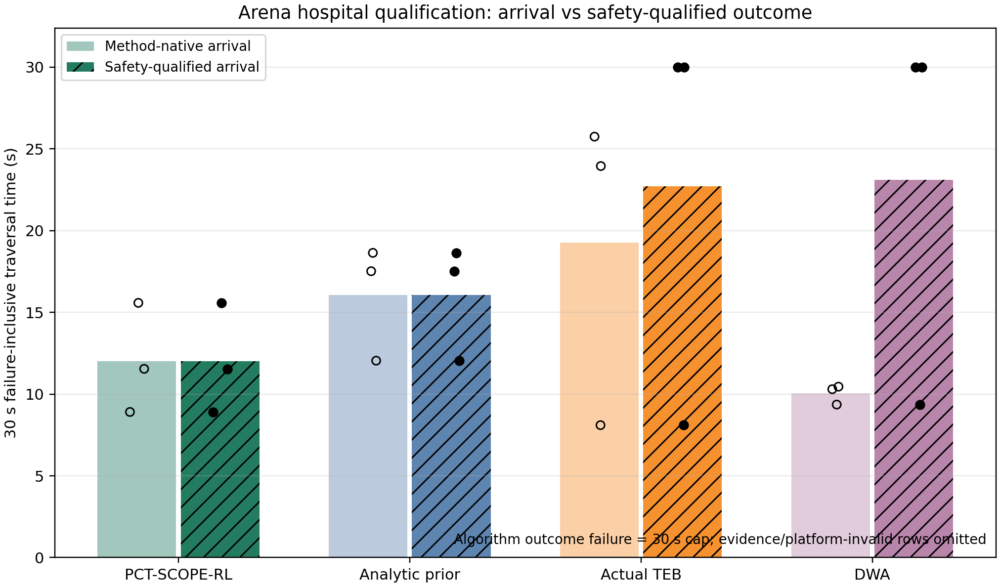
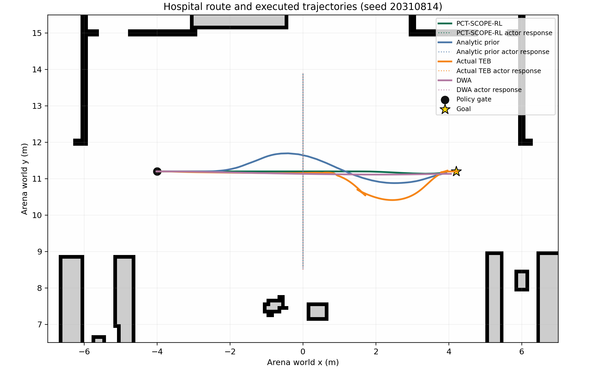

# Arena Hospital 四方法资格对比结果

> 结果性质：Q1 资格/探索性证据，不是正式统计实验。冻结的 hospital 单走廊共 3 个配对块、12 个 episode；所有身份仅执行 attempt=1，无重试、替换或追加训练。

## 场景外观

推荐图注：

> **图 X.X Arena-Rosnav-3D 集成的医院三维环境。** 本图为暂停态平台场景展示，用于说明 hospital 世界的室内资产与空间结构，不是 Q1 算法 episode 的回放，也不构成性能或安全证据。Q1 的量化证据来自下文冻结走廊上的原始报告、轨迹和统一评估器。

## 核心结果

12/12 episode 的证据链、平台完整性和接触心跳均通过，四种方法均实现 3/3 原始到达。按照预注册的统一安全规范，PCT-SCOPE-RL 与解析先验均为 3/3 合格，Actual TEB 与 DWA 均为 1/3 合格。

| 方法 | 原始到达 | 原始到达均时 / s | 安全规范合格 | 安全失败计入均时 / s | 最小保守净空 / m |
|---|---:|---:|---:|---:|---:|
| PCT-SCOPE-RL | 3/3 | 12.011 | 3/3 | 12.011 | +0.115 |
| Analytic prior | 3/3 | 16.067 | 3/3 | 16.067 | +0.076 |
| Actual TEB 0.8.4 | 3/3 | 19.267 | 1/3 | 22.700 | −0.285 |
| DWA | 3/3 | 10.038 | 1/3 | 23.120 | −0.180 |

“安全规范合格”同时要求：证据链与平台完整、到达目标、心跳有效的 bumper 流中未观察到接触状态、独立保守净空不小于 0，以及零 action-mask 违规。安全不合格 episode 以 30 s 计入该口径。

推荐图注：

> **图 X.X Arena Hospital 资格实验的原始到达与安全规范合格结果。** 柱高为 3 个配对块的失败计入平均时间，空心点表示方法原生到达时间，实心点表示统一安全规范口径。Actual TEB 与 DWA 在两个受控横穿块中均到达目标，但因保守净空为负而在安全口径中记为 30 s。该图为描述性资格结果，不包含显著性推断。

## 描述性效应

| PCT-SCOPE-RL 相对比较方法 | 安全口径降低 | 原始到达口径降低 | 解释 |
|---|---:|---:|---|
| Analytic prior | 25.246% | 25.246% | 两者均 3/3 安全合格，是最直接的学习选择层消融证据 |
| Actual TEB | 47.089% | 37.660% | TEB 两个动态块净空不合格，安全效应包含 30 s 封顶 |
| DWA | 48.049% | −19.659% | DWA 原始到达更快；PCT 优势只出现在统一安全规范口径 |

PCT 相对解析先验的三个块方向一致，块级描述性降低分别为 26.04%、34.10% 和 16.41%。由于 PCT 与解析方法共享候选集、预测、硬约束验证和解析回退，这组比较支持：学习辅助候选排序在本冻结任务中改善了安全约束下的通行效率。它不证明统计显著性或跨场景泛化。

## 轨迹与交互效果

推荐图注：

> **图 X.X Arena Hospital 受控横穿任务中的执行轨迹。** 实线为四种方法的机器人轨迹，彩色点线为闭环反应式代理在对应方法下的响应轨迹。四方法共享 M2 机器人、LaserScan、里程计、TF、地图、起终点和 30 s 上限，但内部地图使用语义不同，因此该图表示完整导航系统栈比较，而非完全相同内部信息条件下的单模块隔离实验。

Actual TEB 在两个横穿块中的最小保守净空为 −0.285 m 和 −0.273 m，DWA 为 −0.180 m 和 −0.178 m；这些负值均来自机器人与受控 actor 的保守几何间隔，而不是静态地图碰撞。四个 episode 仍全部到达，接触状态样本均为 0。因此只能写成“违反冻结的保守净空规范”，不能写成“发生碰撞”。Q1 又没有冻结碰撞敏感性正控，所以零接触状态样本也不能单独证明零碰撞或形式安全。

## 本项目方法体现出的先进性

本轮结果支持的是有边界的架构与机制先进性：

1. **学习决策与硬约束解耦。** PCT 只在 Ackermann 可执行候选中做上下文选择，候选仍需通过静态/动态保守净空验证；超限时回退解析先验或认证停车，而不是让策略直接输出未验证控制量。
2. **学习层具有可分离的增益证据。** 相比共享安全架构的解析先验，PCT 在三个块中均缩短失败计入时间，均值描述性降低 25.25%；这比直接把 TEB/DWA 的净空失败归因于“RL 更安全”更能说明学习排序层的作用。
3. **安全—效率双口径可审计。** 结果同时保留原始到达和安全规范合格口径，明确展示了 DWA 原始速度更快的反例，没有用 30 s 封顶掩盖速度代价。
4. **迁移时未追加学习更新。** 冻结 actor 在 Arena hospital 适配器中运行，训练步数为 0；这证明了该接口与这一任务的迁移可执行性，但不等于已经证明一般 OOD 泛化。
5. **证据链失败关闭。** release、独立 review、逐 episode receipt、终态 journal、raw manifest 和外部 seal 相互绑定；平台或证据异常不会进入性能汇总。

可直接用于论文的稳健表述：

> 在冻结的 Arena Hospital 单走廊资格实验中，PCT-SCOPE-RL 未追加学习更新，完成了 3/3 原始到达和 3/3 保守规范合格到达。相较共享候选集与硬约束的解析先验消融，其失败计入平均时间由 16.067 s 降至 12.011 s，描述性降低 25.25%，且三个配对块方向一致。两种受约束候选方法在全部块中保持非负保守净空，而冻结的 Actual TEB 与 DWA 配置在两次受控横穿中均违反该保守净空规范。该结果为学习辅助排序、硬约束验证和解析回退组合在这一受限任务中的安全—效率折中提供了机制证据，但不构成统计显著性、普遍 Arena 优越性或形式安全证明。

## 必须同时披露的反例和局限

- DWA 的原始到达均时为 10.038 s，快于 PCT 的 12.011 s；PCT 相对 DWA 的原始时间降低为 −19.659%。
- 静态块中 Actual TEB 为 8.101 s，PCT 为 8.908 s，PCT 慢约 9.96%。
- PCT 最小正保守净空只有 0.115 m，不能描述为具有宽裕安全余量。
- PCT 的 20 ms 推理期限出现 15/136 次超时回退，约 11.0%；三个 episode 的 P99 推理时延为 52.8、59.1 和 73.5 ms。回退保持了执行，但当前实现不能声称始终满足实时期限，也不能把全部结果解释为纯学习动作效果。
- `path_length_m` 的跳步过滤使 PCT/解析方法明显少计，当前不应用于论文中的跨方法路径长度比较。
- Q1 只有一个 Arena 世界、一条宽直走廊、一个静态块和两个相同几何的谨慎圆柱横穿块；没有转弯、复杂静态绕行、多人、人群、感知、定位或 OOD 证据。
- 三个块不进行置信区间或显著性检验；所有百分比均为描述性均值之比。
- PCT/解析方法具有外部硬 verifier，TEB/DWA 没有同构 verifier；因此不能把系统栈结果外推为一般意义上的 TEB/DWA 算法劣势。

## 可复核证据

- [完整自动分析结果](../../../artifacts/arena_pct_teb_dwa_qualification/q1/analysis/RESULTS.md)
- [逐 episode 表](../../../artifacts/arena_pct_teb_dwa_qualification/q1/analysis/episode_results.csv)
- [方法汇总表](../../../artifacts/arena_pct_teb_dwa_qualification/q1/analysis/method_summary.csv)
- [描述性效应表](../../../artifacts/arena_pct_teb_dwa_qualification/q1/analysis/effect_summary.csv)
- [机器可读证据摘要](../../../artifacts/arena_pct_teb_dwa_qualification/q1/analysis/evidence_summary.yaml)
- [分析文件清单](../../../artifacts/arena_pct_teb_dwa_qualification/q1/analysis/analysis_manifest.json)
- [冻结协议](../../../config/thesis_experiments/arena/arena_pct_q1_contract.yaml)
- [执行 release](../../../artifacts/arena_pct_teb_dwa_qualification/q1_execution_release.yaml)
- [独立 release review](../../../artifacts/arena_pct_teb_dwa_qualification/q1_release_review.json)
- [终态 matrix receipt](../../../artifacts/arena_pct_teb_dwa_qualification/q1/matrix_receipt.json)
- [原始证据封印](../../../artifacts/arena_pct_teb_dwa_qualification/q1_raw_evidence_seal.json)

关键身份：release SHA `5437defd313baa0d85f14bac6f20b80ea180a87441d745d31f492366fd8a6997`；raw evidence seal SHA `c1aec5e810de70fbf6121dfb445c0943dc35100fdde2762d6ced1e7bd61afe6b`；analysis manifest SHA `e1d175320273fdc4e0ae33d5ac966ea07f85f7891cad32bb186ce4583bcb1070`。
