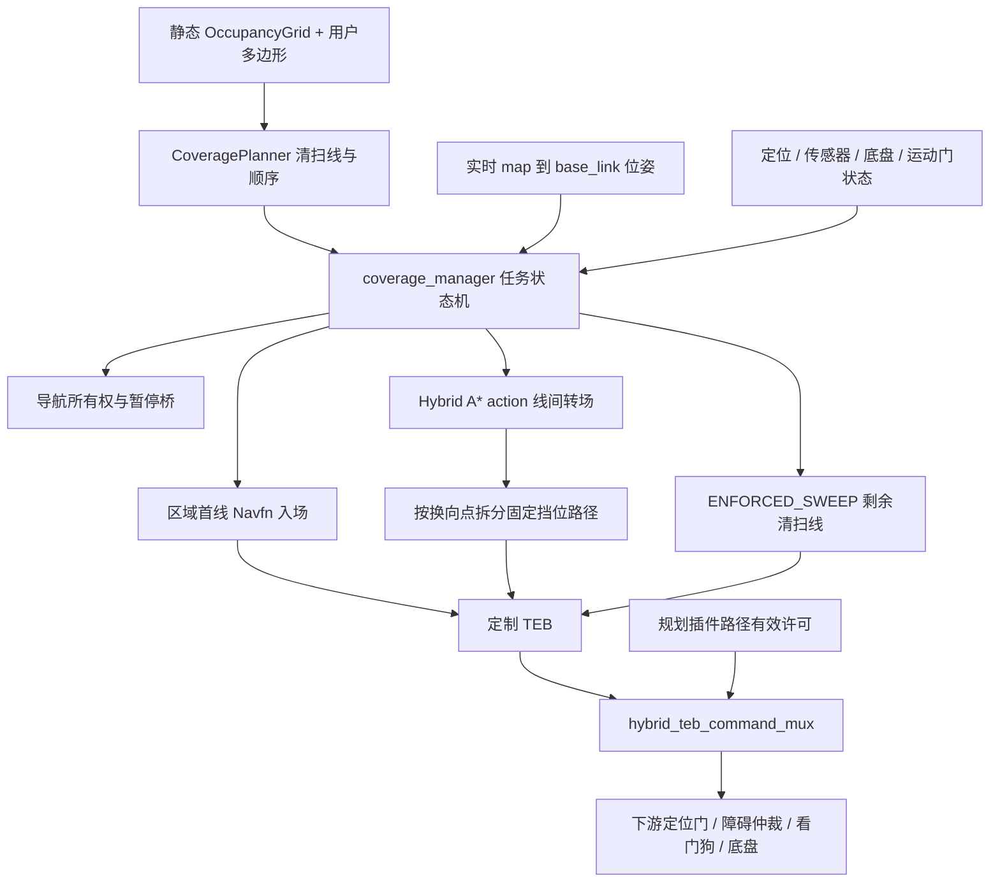

# 覆盖导航架构

## 组件与数据流

* `coverage_geometry.py` 在静态地图上生成可达、符合外廓要求的平行清扫线，比较方向、
  次序及时间估算。几何阶段的连接成本是估计，不能视为实际无碰撞转场路径。
* `coverage_manager.py` 管理区域/批次、计划代次、状态、精确 action ID、取消完成确认、
  入口准入、续扫进度及重试。Hybrid/TEB一轮有限重试耗尽后保留当前转场及其依赖清扫线，
  在安全条件成立时继续下一轮，不把普通执行无进展直接升级为人工暂停。区域多边形是
  作业范围，不是禁止转场绕出的 geofence。
* `CoverageGlobalPlanner` 是 `nav_core::BaseGlobalPlanner` 插件，模式包括普通 Navfn、
  覆盖首入场 Navfn、Hybrid 转场路径校验、强制清扫线。Navfn 查询用同一互斥锁串行。
* `hybrid_a_star.cpp` 使用车辆运动原语、代价地图外廓检查和 Reeds–Shepp 解析连接。
* 仓库内 TEB 与固定挡位、强制路径和覆盖动作序号配套；新动作或恢复动作会清理旧优化带
  和振荡/不可行历史，错误挡位保持零输出并等待连续同向可行解。发行版 TEB 二进制不替代
  这份源码。
* `hybrid_teb_command_mux.py` 检查路径挡位、许可新鲜度、命令新鲜度和车辆曲率。
  它的输出仍是上游导航命令，实车最终看门狗和底盘放行由集成方负责。

## 转场搜索与结果选择

每次冻结一份实时代价地图快照，按 6×6 m、10×10 m、全图逐级搜索。
源项目启动配置对应 0.75/1.25/3.00 秒阶段预算，滚动/恢复总预算 5.00 秒。
每层启动两路独立搜索：启发权重 1.05 和 1.35，输入地图、起终点和运动约束相同。
这两路没有“前进起步线程/倒车起步线程”的固定分工。

首个成功结果出现后，另一条未完成搜索有约 0.10 秒比较窗口。成功候选优先换向少，
再按预计行驶时间短选取；完全相同保留第 0 路。主循环、启发式构建和解析连接响应取消。
当前返回的 expansions 是两路总和，结果未记录获选 lane/TID，无法从 CPU 曲线补推。

Action 外层 success 表示请求处理是否完成；必须检查每个 result.outcome==0 和路径。
外层 success=true 仍可能携带目标无效的结果，不能将其算作规划成功。

## 入口与三个不同的距离约束

| 约束 | 作用 | 与清扫准入关系 |
|---|---|---|
| 管理器入口位置 0.40 m、航向 25° | 判断实际车辆是否能够交接到清扫线 | 满足时按原准入流程进入清扫 |
| 清扫前方障碍检查默认 5 m | 每次从实时位置沿剩余线检查近端致命障碍 | 窗口随车前进，完整剩余线仍交给 TEB |
| Hybrid 路径检查前视 3 m | 转场执行的近端路径许可 | 独立于清扫窗口 |
| entry_recovery 总长 4 m | 对已确认越过入口的特殊恢复约束 | 不施加给全部规划或全部转场 |

4 米恢复限制仅在可信最终接近、进度达到 85%、沿原行进方向越过入口平面至少 0.02 m、
距入口不超过 2 m 且实际位姿仍在原入口容差外时启用。进入容差仍走原清扫交接，不能
额外要求“曾越界”才准许清扫。规划器目标容差与管理器入口容差属于不同层级。

5 米参数在 `config/coverage_global_planner.yaml`；必须有限且大于零。窗口内完整带
padding 外廓检查保留，未知空间、地图边界及 TEB 局部检查保留，不会清除全局地图障碍。

## 任务和所有权

状态包括 IDLE、READY、PREPARING、GOING_TO_START、TRANSITING、SWEEPING、
WAITING_OBSTACLE、PAUSED 和终态。管理器在发目标前领取 coverage owner token，
普通导航与覆盖目标共享所有权桥。暂停、取消和计划代次共同防止旧回调污染新计划。

首入场预览使用 `/move_base/CoverageGlobalPlanner/make_navfn_plan` 查询服务，锁存
`/coverage/first_entry_path`，不发送运动目标。执行前预检失败时可保留预览；换图、
取消和新任务会清除。清扫中断恢复保存原线身份和进度，不支持进程重启后自动恢复。

清扫跟踪同时保存map位姿和新鲜底盘`/odom`。相邻map样本超过原0.50 m门时，只有物理
里程位移能在速度包络内解释该变化，且旋转到map后的位移残差在配置容差内，才继续计入
进度。暂停后最多在配置窗口内记录制动轨迹；连续停车后关闭窗口，稍后的遥控移动不会被
计入覆盖。手动恢复必须保留原入口历史、位于原清扫走廊并且没有异常倒退，随后仅下发
未完成后缀。

普通导航可通过同步的单目标策略服务选择终点朝向自由。全局规划器把策略绑定到精确目标
和时间戳，再用独立路径序号传给TEB；TEB只在XY进入容差且新鲜物理里程计确认停车时完成。
该协议不改变覆盖路径和普通固定朝向目标。

## 关键源码

算法和状态机均在 `src/application/autolabor_coverage`；接口由 msg/srv/action 明确定义。
导出的所有权桥保留在 `src/platform/autolabor_dual_host/scripts`，但没有复制完整
双机启动包。实车输入要求及需要自行提供的最终控制链见 [PORTING.md](PORTING.md)。
