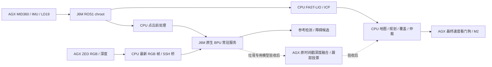

# J6M + BPU 导航算法工具链初稿

源码基线为 `robot_j6m_ws_navigation_20260907` 的 **0914 当前工作树**，包括尚未提交的现场
修复。`SOURCE_MANIFEST.json` 记录每份源码的 SHA256；Git HEAD 不能单独表示该版本。

本包提供现有 ROS1 双机导航、BPU 适配源码及正式垃圾模型的 PTQ 准备工具。
它是可供地平线审阅的工程初稿，尚未提交到平台，也不是可直接安装的整机镜像。
源码中的现有部署脚本保留现场路径保护；换机器后须适配依赖和生命周期，不能直接运行。

2026-10-10 续接已恢复网线访问，并在 J6M 新私有目录部署通用 BPU 执行层和单模型桥。
最终参考 FCOS 对照、真实通信和既有 CenterPoint 推理通过；正式垃圾双模型仍未编译成
HBM，也未替换 GPU 后端。详见 [板端适配记录](../../docs/J6M_BPU_BOARD_ADAPTATION_20261010.md)
与 [验证摘要](board_validation_summary.json)。完整导航双网检查仍因专用 USB 网卡缺失未通过。

## CPU、BPU 与双机分工

| 功能 | 执行位置 | 计算资源 | 状态 |
|---|---|---|---|
| MID360/IMU 物理接收、前后 LD19、USB-CAN/M2 | AGX | CPU | 保留现场接口 |
| ROS master、Livox relay | J6M chroot | CPU | 已有部署记录 |
| FAST-LIO、点云去畸变、三维先验 ICP 定位 | J6M chroot | CPU | 已有部署记录 |
| map_server、MID360/LD19 融合、move_base、Navfn/Hybrid A*、TEB | J6M chroot | CPU | 已有部署/覆盖实验记录 |
| 覆盖任务、暂停恢复、视觉伺服、速度仲裁 | J6M chroot | CPU | 保留原控制链 |
| FCOS COCO 检测网络 | J6M 原生系统 | BPU | 已有实机记录；参考检测 |
| FCOS 图像前处理、源帧深度配对、垃圾几何候选 | AGX | CPU | 与 ZED SDK 同侧 |
| CenterPoint 筛点、pillar 编码、解码 | J6M | CPU | 已有适配 |
| CenterPoint 网络 | J6M 原生系统 | BPU | 已有实机记录；障碍候选 |
| YOLO11-GAM 单类垃圾检测 + 五类材质分类 | 当前 AGX；目标 J6M | 当前 CUDA；目标 BPU | ONNX 已验证；PTQ/HBM/实时后端待验收 |
| ZED 深度、Qt/RViz、AI/ASR、最终速度看门狗 | AGX | CPU/GPU | 当前仍需 AGX |

CPU 算法不会通过模型编译器自动迁到 BPU。提高 J6M 参与度的主要下一步是垃圾专用双模型
及其板端服务；可另行评估地平线 DSP 的 CenterPoint 前处理，但本稿没有宣称 DSP 已接入。
`CenterPoint -> TEB` 仍保留原禁止启用逻辑，COCO 类别不会重命名成垃圾材质。



## 已完成的部署适配入口

FCOS 的远端地址和桥脚本路径可以通过 `fcos_rgbd.launch` 的 `bpu_ssh_target`、
`bpu_relay_path` 参数配置；默认仍为现有 `root@192.168.10.100` 与项目私有 `/map` 路径。
Python `Client` 也支持相同参数。主导航仍通过原统一入口管理两端，修改 FCOS 地址本身
不会迁移 ROS master、J6M 导航或原生 BPU 服务。

ROS Noetic 在 Ubuntu 20.04 ARM64 chroot，BPU 推理在 J6M 原生用户态，私有运行库仅供
推理进程使用。禁止把私有 HBRT 加进整个 ROS 的 `LD_LIBRARY_PATH`，也不能复制 AGX
`devel` 到板端。参考服务仍锁定已验证模型 SHA 与原 tensor 契约，不能把任意 HBM 塞进去。

### 新增通用板端执行层与单模型桥

`native/tensor_executor.cpp` 和 `tools/native_tensor.py` 使用当前板端私有
DNN 3.14.5 / HBRT 4.9.2，读取实际 tensor 属性，复用设备内存，按 stride 打包、解包
及轴相关反量化。支持未量化 F32/U8 输入，SCALE 整数或 F32 输出；现有 CenterPoint
的量化输入与36输出继续使用原适配器。`build_tensor_executor.sh` 校验私有依赖哈希，
使用只读现有 sysroot，仅在新的候选目录构建；厂商依赖没有包含在本源码包。

`tensor_stdio.py` / `tensor_transport.py` 提供 SSH 二进制 tensor 通信、长度/超时、
模型哈希、源帧序号/时间戳/帧龄检查。每连接只常驻一个模型，使用既有独占锁，
响应保持候选属性，不发布 ROS 消息。`production_io.py` 提供固定正式模型的
CPU 前处理和后处理；90份实际前处理和8份 FP32 ONNX 输出检查通过。

当前工程中的复核命令如下，报告使用新文件名以保留旧证据：

```bash
./scripts/optimized.sh run bash -c 'source scripts/setup_env.sh; \
  python3 -m unittest discover -s distribution/j6m_bpu_navigation/test -p "test_*.py" -v'
./scripts/optimized.sh run bash -c 'source scripts/setup_env.sh; \
  python3 distribution/j6m_bpu_navigation/tools/verify_tensor_transport.py \
  --library /map/robot_j6m_navigation_20260907/bpu_production_20261010/build_v5/libj6m_tensor.so \
  --report runtime/new_tensor_round_trip.json'
```

第二条需要当前已验证板端目录与恢复的网线连接，只使用固定参考 FCOS 合成输入。
三帧往返约85–101 ms，不能作为正式垃圾模型精度、持续帧率或多 crop 性能验收。

## 正式垃圾模型 PTQ 准备

`production_models.json` 固定两份已有 ONNX：垃圾检测为 `1×3×576×1024`，输出
`1×5×12096`；材质分类为 `1×3×224×224`，输出 `1×5`。五类顺序固定为
`metal, plastic, paper, glass, kitchen_waste`。检测保留 GAM，分类初稿为 batch=1；
生产最多8个 crop 的延迟预算需另行验证，不能用单张分类耗时代替。

在原工作区内，本地工具通过 `scripts/optimized.sh run` 执行，输出放到 `runtime`。
在导出的审阅包/x86 开发环境中可以直接运行对应 Python 工具。

1. 只读复用历史导出，校验 SHA、类别、GAM 记录及实际 ONNX shape/checker：

   ```bash
   python3 distribution/j6m_bpu_navigation/tools/production_ptq.py prepare \
     --exports /path/to/verified/exports --output /path/to/new/private_ptq
   ```

   初稿按官方 `hb_compile` 配置生成 `nash-m`、单 BPU core 的两份任务。
   使用已归一化 float32 `featuremap` 输入，CPU 先保持原始 RGB 前处理，避免新增 NV12
   色彩转换改变精度对齐。生成配置不代表工具链已接受模型。

2. 明确选取训练集校准样本，JSON 格式如下；分类至少包含全部五类，至少20份唯一样本：

   ```json
   {"split":"train","samples":[{"path":"train/image01.jpg","class_name":"metal"}]}
   ```

   对检测样本 `class_name` 使用 `trash`。样本覆盖光照、距离、小目标及背景；分类最好使用
   与现有20% context crop 相同的真实裁剪分布。标签由数据负责人确认，工具只检查声明，
   不会推断样本是否真的属于训练集或类别。测试/验证集留给独立评测。

   ```bash
   python3 distribution/j6m_bpu_navigation/tools/calibration_images.py \
     --model classifier --images /path/to/train_selection.json \
     --ultralytics-root /path/to/custom_yolo11_GAM \
     --checkpoint /path/to/material_yolo11s_cls/best.pt --output /path/to/new/calibration
   python3 distribution/j6m_bpu_navigation/tools/production_ptq.py attach-calibration \
     --workspace /path/to/private_ptq --model classifier \
     --manifest /path/to/new/calibration/manifest.json
   ```

   对 `detector_zed` 重复一次。工具调用已有定制 Ultralytics 的 LetterBox 或分类 transforms，
   分类还核对固定 checkpoint 中保存的 transforms；记录图片/张量/前处理源码哈希，
   拒绝对象 pickle、非有限值、尺寸错误和重复张量。

3. 使用独立 **x86_64 OpenExplorer** 环境，提供 `environment_id`（镜像 digest 或 SDK
   发布标识）与 `packages`（已安装工具链包名到精确版本的映射）的 JSON 锁文件。
   至少记录 `horizon-tc-ui` 与 `hbdk4`；不得把占位版本作为实测版本。

   ```bash
   python3 distribution/j6m_bpu_navigation/tools/production_ptq.py verify \
     --workspace /path/to/private_ptq --require-calibration
   python3 distribution/j6m_bpu_navigation/tools/production_ptq.py run \
     --workspace /path/to/private_ptq --toolchain-lock /path/to/sdk_lock.json
   ```

   校准缺失、SHA/配置变化、工具版本不符或已有编译输出会拒绝执行。保留编译日志/HBM
   哈希；即使编译成功，也仍标记 `production_ready=false`。没有伪校准/fast-perf 替代验收。

## 后续接入与验收

GAM 的 MatMul/Softmax 必须审查 J6M 算子落点及 CPU fallback 开销。量化精度用独立标注集
检查垃圾召回、误检、材质混淆矩阵和小目标；板端再对齐同一输入的 golden outputs。
查询 HBM 实际 dtype、layout、stride、scale，不能假设它仍等于 ONNX FP32 接口。

单模型执行和通信基础已实现，专用垃圾双模型实时服务尚未实现。下一步应常驻两模型，
保持最新帧、原时间戳/序号、小体积结果、
源帧深度配对（原20ms容差）、BoT-SORT/材质投票和500ms帧龄限制；用独立观察 topic
验证断连/延迟/重连后再接入正式 `/fod/detections`。当前不增加第二个最终速度发布者。
同场景、同帧率的 GPU/CPU/BPU A/B 与导航竞争测量通过后，才证明资源迁移收益。

## 打包与地平线审阅

原工作区入口：

```bash
./scripts/optimized.sh run python3 scripts/export_j6m_bpu_navigation.py \
  runtime/new_j6m_bpu_draft
```

输出源码目录、`.tar.gz`、`.sha256` 和逐文件清单。保留项目改动后的实际源码及各组件
许可证；不附权重、HBM、厂商运行库、地图、现场数据、私有配置或 Git 历史。
FAST-LIO/LD19/定制 TEB 等源码包含在包内；ROS Noetic、Livox SDK/driver、导航依赖、
定制 Ultralytics、ZED SDK 与地平线 SDK 需按各自授权单独取得。
项目既有脚本还引用工作区其他文件，因此本包提供审阅和迁移入口，不宣称一键复现完整车栈。

`oe.horizon.auto/labs` 是用户指定的算法资源/提交目标。本次可读取其站点入口，但没有核实
当前投稿接口、账号权限或接收规范；此包没有被上传，也不冒充地平线官方插件。

参考资料（查阅日期 2026-10-10）：

- [地平线算法资源](https://oe.horizon.auto/labs)
- [J6M/nash-m 与 hb_compile 配置](https://doc.oe.horizon.auto/3.8.1/guide/tools_guide/ptq_tools/hb_compile/convert.html)
- [校准集与输入对齐](https://doc.oe.horizon.auto/3.8.1/guide/model_compile/ptq/ptq_basic_process/prepare_data.html)
- [FCOS 参考训练流程](https://doc.oe.horizon.auto/3.7.0/en/guide/advanced_content/hat/examples/fcos.html)
- [CenterPoint 参考训练流程](https://doc.oe.horizon.auto/3.8.1/guide/reference_algorithm/examples/centerpoint.html)

查阅的文档版本是配置依据，板端历史私有 HBRT 4.9.2 / DNN 3.14.5 不能据此认定兼容
新编译器。首次 HBM 仍需厂商版本配套确认和板端无运动验证。
