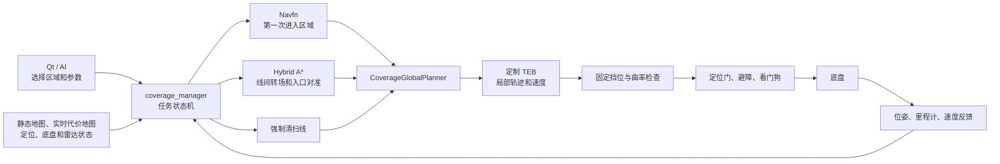

# 覆盖管理系统说明及 0.30 m 短路径问题

## 一句话说明

`coverage_manager` 是覆盖任务的总调度器，但它不直接计算底盘速度。它把区域拆成清扫线，
依次安排首入场、直线清扫和线间转场，再把每一段交给 Navfn、Hybrid A*、TEB 和安全链。
所谓 sweep tracker 不是另一个节点，而是管理器内部一组用于判断“这条线是否真的从入口
连续走到终点”的临时变量。

当前缺陷不是“多了一个管理器”，而是同一个覆盖管理器内部用 0.40 m 允许清扫开始，
又用 0.30 m 才允许完成记录启动，产生了 0.30–0.40 m 的判据空档。

## 系统中的角色

各部分职责如下。

| 部分 | 做什么 | 不做什么 |
|---|---|---|
| Qt/AI | 选择 A/B/C 区域，设置幅宽、重叠、速度，发计划、开始、暂停、恢复、跳区或取消 | 不生成底盘速度 |
| 覆盖几何规划 | 在多边形和静态地图内生成平行清扫线，比较方向和清扫顺序，估计面积及时间 | 预览连接线不是最终实车转场轨迹 |
| `coverage_manager` | 保存 plan/batch、安排段顺序、领取导航所有权、检查安全状态、发 action、处理完成/暂停/重试 | 不做 TEB 优化，不直接控制转向电机 |
| Navfn | 从车辆当前位置到第一条清扫线入口，生成普通无倒车拓扑的全局路线 | 不负责后续阿克曼 U 形转场 |
| Hybrid A* | 按前轮转向车辆的最小转弯半径，从实时停车位姿规划后续线间转场 | 不跟踪路径，不直接输出速度 |
| `CoverageGlobalPlanner` | 作为 move_base 全局规划插件，按当前模式提供 Navfn、Hybrid 路径或强制清扫线，并检查代价地图 | 不决定整个区域的任务顺序 |
| TEB | 根据全局路径、障碍和车辆约束生成短时局部轨迹及 `vx/omega` | 其“Goal reached”不能单独证明整条清扫线已经清扫 |
| Hybrid TEB mux | 检查固定挡位、路径/许可新鲜度、曲率和路径跟踪误差，不合格就输出零 | 不重新规划路径 |
| 下游安全链 | 检查定位、避障、运动授权、命令超时和底盘急停，再向 VCU 输出 | 不修改覆盖任务状态 |

## 区域如何变成 8 个段

当前默认作业幅宽为 1.00 m，重叠率为 15%，所以相邻清扫线中心间距为
`1.00 × (1 - 0.15) = 0.85 m`。几何规划会把用户多边形与可通行地图相交，生成长度不小于
1.20 m 的平行线，并选择方向、起点和访问顺序。

例如一个区域有 4 条清扫线，执行序列通常是：

| 段号 | 类型 | 含义 |
|---:|---|---|
| 1 | entry | 当前车位到第 1 条线入口，Navfn + TEB |
| 2 | sweep | 第 1 条清扫线，强制前进 |
| 3 | transit | 第 1 条线终点到第 2 条线入口，Hybrid A* + TEB |
| 4 | sweep | 第 2 条清扫线 |
| 5 | transit | 到第 3 条线入口 |
| 6 | sweep | 第 3 条清扫线 |
| 7 | transit | 到第 4 条线入口 |
| 8 | sweep | 第 4 条清扫线 |

所以今天状态中的“第 6/8 段”是第 3 条清扫线，不是第 6 条清扫线。

## 从规划到执行的完整流程

### 1. 计划阶段

Qt 或 AI 把区域多边形和任务参数发给 `/coverage/plan` 或批次接口。管理器检查地图摘要，
计算请求面积、可达面积、清扫方向、线数、预估清扫时间和预估转场时间，并生成唯一
`plan_id`。界面上的完整折线是任务预览，后续线间转场仍会在实车到达线尾后，按实时位姿
重新运行 Hybrid A*。

### 2. 开始前检查

开始服务会确认：计划仍是当前计划、地图没有变化、定位为 `LOCALIZED`、雷达/避障数据
新鲜、底盘没有持续故障、运动门允许、普通导航没有被其他模块占用。管理器随后领取
coverage 导航 owner token，防止普通导航、待清扫和覆盖同时向 move_base 发目标。

### 3. 首次入场

第一次进入区域使用 Navfn + TEB。Navfn负责绕开普通地图障碍，TEB负责把路线变成车辆可
执行的局部速度。到第一条线以后，管理器检查入口位置和朝向，再进入清扫。

### 4. 直线清扫

管理器发布 `MODE_ENFORCED_SWEEP`，全局规划器只提供指定清扫线，TEB必须沿线前进。
清扫碰撞检查不是检查整条线，而是从实时车位沿剩余清扫线查看前方 5 m；窗口随车辆前进。
检查使用带 padding 的完整车体外廓，未知空间和地图边界仍拒绝。TEB还会继续检查局部轨迹。

### 5. 线间转场

上一条线完成后，管理器从车辆实际停车位姿向下一条线入口请求 Hybrid A*。当前车辆模型
采用 0.65 m 轴距、1.35 m 最小转弯半径；需要约 25.7°转角，底盘上限约 28°。

Hybrid A* 的主要离散参数是：

| 参数 | 当前值 | 含义 |
|---|---:|---|
| 运动原语长度 | 0.30 m | 搜索树每次尝试向前或向后走的一小步 |
| 碰撞采样间隔 | 0.10 m | 每个原语内部每 10 cm 检查一次外廓 |
| 平面状态分辨率 | 0.15 m | 搜索状态的空间离散粒度 |
| 航向格数 | 72 | 一圈分成 72 个方向，约 5°一个格 |
| 转向样本 | 5 | 每个状态尝试 5 种转角 |
| 最大展开 | 80,000 | 单个搜索的节点上限 |

搜索先尝试 6×6 m 局部窗口，再尝试 10×10 m，最后可退到全图。每层同时运行两路搜索，
主要区别是启发权重 1.05 和 1.35；它们都允许前进和倒车，不是“前进线程”和“倒车线程”。
首个结果出现后给另一条线程约 0.10 s 改善机会，最后优先换向次数少，再比较预计时间。
当前日志只保存两路总展开量，没有保存最终采用的 lane。

### 6. 换向点如何执行

Hybrid 路径可能是“前进—倒车—前进”。每次方向改变称为 cusp。覆盖管理器会把一条路径
按 cusp 拆成多个固定挡位 action：每段只能全前进或全倒车，段与段之间必须停车。

每次安装新 action 都分配动作编号。TEB看到新编号后清除上一动作的局部带、振荡历史和
转向偏好。若要求前进但 TEB生成负速度，固定挡位保护输出零，只在该恢复过程第一次清带，
然后要求连续 5 个同向可行解才放行。

到达 cusp 后，管理器比较实车停车姿态和缓存后缀。接续方向误差不超过约 5.7°时可修剪
最多 0.30 m 并继续；误差更大时丢弃后缀，从实车位姿重新规划完整剩余转场。

## 几个容易混淆的距离

| 数字 | 用在哪里 | 不是做什么的 |
|---:|---|---|
| 0.30 m 运动原语 | Hybrid A*的一步 | 不是清扫线长度 |
| 0.30 m 内层入口目标 | Hybrid规划尽量进入的较小目标区 | 不是覆盖管理器最终入口容差 |
| 0.40 m / 25° | 覆盖管理器允许交接到清扫线的入口容差 | 不是所有 Hybrid 路径完成条件 |
| 0.30 m 横偏 | 清扫完成记录当前的启动和末端横偏要求 | 与 0.40 m 交接门不一致，形成当前缺陷 |
| 0.45 m | 清扫记录要求接近线首的距离，以及入口偏离保护使用的量级 | 不是 entry_recovery 路径长度 |
| 2 m | 覆盖模式下 TEB使用的全局路径前视长度；也用于特殊入口恢复的近入口范围 | 不限制完整 Hybrid 路径只能有 2 m |
| 3 m | Hybrid执行路径的近端碰撞许可窗口 | 不限制规划路径总长 |
| 4 m | 已确认越过入口后的特殊 entry_recovery 总长上限 | 不限制普通首入场或线间转场 |
| 5 m | 清扫时从实时位置向前的障碍检查窗口 | 不表示只清扫 5 m |

### 4 m 特殊入口恢复何时出现

普通转场失败、普通入口超差或尚未到达入口时，不应启用 4 m 限制。只有系统已经连续跟踪
最终接近段、完成至少 85% 有向进度、沿行进方向越过原入口平面至少 0.02 m、当前又落在
0.40 m/25°入口容差之外，且距入口不超过 2 m时，才进入特殊 entry_recovery。此时 4 m
用于阻止车辆越过入口后又规划很长的前进绕圈。

代码中“rolling entry alignment”和“entry_recovery”名字相近。前者是一般的实时入口对准，
后者才是受 4 m 特殊上限和特殊代价约束的越界恢复。

## 管理器如何判断完成

系统里有三种不同层次的“到达”。

### TEB/move_base 到达

局部控制器认为车辆已经进入目标容差，可能返回 `SUCCEEDED`。它只说明局部目标接近，不能
证明整条清扫线已经经过。短路径和较大容差下尤其容易提前到达。

### 转场到达

管理器观察实车位姿，判断车辆是否越过转场边界、是否在入口位置和朝向范围内，并确认
物理里程计连续两次低于 0.08 m/s。普通中间 cusp通常要求至少 85% 有向进度；最终清扫线
入口有一个例外：只要进入 0.40 m/25°业务容差，就可交接，不强制追到 Hybrid离散路径的
内部末点。

### 清扫线完成

管理器内部为当前清扫段保存几个字段：是否已在入口开始记录、上次位置、沿线最大进度、
连续完成样本数以及是否发生位姿跳变。代码把这组字段称为 tracker，它没有独立 ROS 节点、
线程、规划器或控制权。

当前完成条件包括：

1. 在距离线首不超过 0.45 m、横偏不超过 0.30 m、朝向误差不超过约 25°时开始记录；
2. 相邻采样位姿跳变不超过 0.50 m；
3. 最大有向进度至少达到线长的 90%；
4. 车辆沿正确方向越过终点平面至少 0.02 m；
5. 终点横偏不超过 0.30 m、航向误差不超过约 20°；
6. 实际线速度不超过 0.08 m/s；
7. 上述终点条件连续满足两次。

它防止四类误完成：从线中间开始却把整线记完成、定位瞬移越过终点、TEB只进入宽目标
容差就返回成功、车辆从错误方向穿过终点。

`coverage_ratio` 是已走面积的估算，可随沿线运动接近 75%；它不是段状态提交。只有当前
清扫段通过完成条件，状态机才会从第 6 段进入第 7 段并请求下一条 Hybrid转场。

## 22:16 的 0.30 m 路径到底是什么

现场顺序如下：

1. 第 5 段转场结束后，车辆距第 3 条清扫线入口 0.403 m，管理容差为 0.400 m，只差 3 mm；
   横偏为 0.339 m，仍在 0.400 m 入口横偏容差内，朝向也合格。
2. 因总位置差多出 3 mm，管理器没有直接开始第 6 段，而是从实车位姿请求一次滚动 Hybrid
   入口对准。
3. Hybrid A*使用 0.30 m 运动原语，返回一条长度 0.30 m、全倒车、57 次节点展开的路径。
   这不是清扫线，也不是让车辆固定倒 0.30 m 的人工命令，而是搜索器能给出的一个离散步。
4. 执行约 0.802 s 后，覆盖管理器测得沿该临时路径只前进了 1.6%，约 0.005 m；相对该
   离散路径末点仍差 0.294 m。但此时实车已经进入最终入口的 0.400 m业务容差，所以管理器
   按“最终入口不追逐内部格点”的例外结束了该 action。
5. 第 6 段随后允许开始，因为入口交接检查使用 0.400 m横偏容差；但清扫完成记录要求横偏
   不超过 0.300 m 才启动。原 0.339 m横偏大概率没有被几毫米运动修正到 0.300 m以内。
6. 车辆因此可以实际沿第 3 条线行驶，面积进度也升至约 74.85%，完成记录却很可能始终
   没有启动。车辆到终点后，TEB又持续生成反向速度，被固定挡位门压零并最终中止。
7. 因第 6 段没有可信的“入口到终点”记录，管理器不能提交该线完成，所以不会创建第 7 段
   到下一条线的路径。点击恢复只会重新检查同一记录，仍然拒绝。

日志没有直接打印 tracker 的 `armed` 位，因此第 5 步是由门限和连续现场数据得到的高可信
推断。定位全程保持 `LOCALIZED`，可见 action 反馈最大相邻跳变只有 0.126 m，明显小于
0.50 m失效阈值，不支持持续定位丢失或大跳变解释。

## 暂停、恢复、取消和批次

| 操作 | 管理器行为 |
|---|---|
| 暂停 | 精确取消本管理器当前 move_base GoalID，保留 plan、当前段和可续跑记录 |
| 恢复 | 重新检查定位、底盘、避障、旧目标是否终止和当前段连续记录；合格才重发剩余段 |
| 跳过区域 | 在批次中结束当前区域，记录 partial/skipped，进入下一地区 |
| 取消 | 终止当前 action，释放导航所有权，清除活动计划；之后不能用恢复继续原任务 |
| A/B/C 批次 | 一个 `batch_id` 按顺序执行多个不可变区域，状态记录当前索引和各区域结果 |

如果清扫段中止但完成记录可信，管理器可从当前位置生成剩余直线并继续。如果记录未启动或
已失效，当前代码转为 `PAUSED` 并要求人工检查。今天点击恢复无效，就是恢复前置检查每次
都得到同一个“不可信”结论，而不是按钮没有调用服务。

### 为什么有的暂停能恢复，有的不能

Qt只根据状态里的 `paused=true` 把按钮显示成“恢复覆盖清扫”。这个布尔量把不同性质的
暂停放在了一起，界面没有告诉操作员“现在能否恢复”以及“还缺什么条件”。点击按钮后的
实际处理分为两层：

1. 服务入口先检查活动任务、定位、FOD安全暂停、避障数据和底盘状态。任何一项不合格，
   服务直接返回失败，暂停保持不变。
2. 第一层通过后，服务只清除 `manual_pause` 并返回 `coverage resuming`。任务线程随后对
   当前段再次检查旧Goal是否已终止、车辆是否稳定停车、实时位姿是否仍在原路径走廊，
   以及清扫入口到当前位置的连续历史是否可信。这里失败会立即再次置为 `PAUSED`。

因此现场会有四种表现：

| 表现 | 典型原因 | 点击恢复后的结果 |
|---|---|---|
| 条件已经恢复，可直接续跑 | 操作员主动暂停；底盘急停曾触发但已经解除；雷达曾掉线但已经恢复；定位重新变为 `LOCALIZED` | 从当前段重新规划，清扫段从可信的剩余直线继续 |
| 外部条件仍未恢复 | FOD安全仲裁仍暂停；定位不是 `LOCALIZED`；`/scan`或双雷达状态仍失效；VCU反馈过期、急停或控制器故障仍存在 | 按钮请求直接失败，Qt显示具体前置条件 |
| 转场执行正在自动恢复 | Hybrid/TEB无进展、路径偏离、入口或转场连续重试耗尽、越过转场边界后还没确认停车 | 2026-09-12源码改为保留同一清扫线，等待停车并持续自动重规划，不再要求点击恢复 |
| 当前保存状态无法支撑续扫 | 清扫完成记录从未武装或已经因定位跳变失效；当前位姿离开保留清扫走廊；原任务已取消并清除了活动计划 | 第一层可能显示“正在恢复”，但任务线程立即再次暂停；任务若已是 `CANCELED`，则直接提示没有活动覆盖任务 |

当前源码会主动进入 `PAUSED` 的主要触发有：避障感知丢失、底盘/VCU执行故障、FOD仲裁
暂停、定位失效或位姿跳变、清扫线连续历史不可信、车辆离开清扫走廊，以及首次Navfn入场
在限定次数内反复失败。2026-09-12修改后，Hybrid转场、入口Hybrid对准的重试耗尽，以及
转场路径偏离后的停车等待不再以这些执行原因进入人工暂停。普通清扫线遇到暂时障碍时
通常也进入 `WAITING_OBSTACLE` 并自动重试。真实安全条件丢失、清扫恢复证据不可信或首次
入场失败仍会进入 `PAUSED`。

已发生的两类现场实例正好说明差别：

- 2026-09-09第三轮先因VCU `robot emergency` 暂停约17.5秒；急停解除后恢复成功。后来
  当时部署版因Hybrid有路径但TEB连续无进展，在转场重试耗尽后暂停约21.5秒；人工恢复后
  重新规划并完成。2026-09-12源码已去掉后一种人工暂停。
- 2026-09-11 22:16的第6段，入口交接按0.40m门限放行，但清扫完成记录使用0.30m武装
  门限，很可能从未建立入口到当前位置的可信历史。TEB中止后，每次点击都在第二层得到
  `continuous entrance-to-current-pose history is untrusted`，因此马上再次暂停。仅点击
  无法凭空补造已经丢失的入口历史，最终只能取消任务。

这也是当前交互设计的问题：`PAUSED`不等于“点击即可恢复”，但Qt把所有暂停都显示成同一
按钮。后续应在状态消息中增加明确的恢复分类，例如“现在可恢复”“等待定位/雷达/底盘”
“需要改变车辆位姿或清障”“当前段历史失效，只能取消并重新生成”，并把内部精确原因展示
出来。同时应修复0.40m入口准入与0.30m清扫记录武装的不一致，让被管理器允许开始的清扫
必然具备可恢复的连续记录。

2026-09-12的修改只改变转场执行故障的等待策略：一次有限重试窗口耗尽后，状态进入
`WAITING_OBSTACLE`并继续下一轮；路径偏离、到达转场边界或进入清扫入口后未能在3秒内
确认停车，则持续等待新鲜物理里程计，连续两个样本不超过0.08m/s后自动继续。等待期间
不提交新目标。操作员主动暂停、取消、FOD暂停、定位丢失、雷达失效和VCU故障仍优先中断
自动过程。该修改已于2026-09-12随J6M release `20260912_011633`部署；部署后保持停机，
尚未完成实车转场验收。

AI不是覆盖管理器的一部分，但能调用这些接口。今天第一轮中，AI会话心跳超过 3 s后，
AI任务 runner调用了覆盖取消；取消与暂停语义不同，覆盖管理器按指令清除了活动任务。

## 当前状态机

| 状态 | 含义 |
|---|---|
| `IDLE` | 没有可执行计划 |
| `PLANNING` | 正在把区域生成清扫线和顺序 |
| `READY` | 计划完成，尚未执行 |
| `PREPARING` | 检查实时安全条件并领取导航所有权 |
| `GOING_TO_START` | 首次 Navfn 入场 |
| `TRANSITING` | 线间 Hybrid转场或滚动入口对准 |
| `SWEEPING` | 执行强制清扫线 |
| `WAITING_OBSTACLE` | 当前清扫线受阻或等待重试 |
| `PAUSED` | 人工暂停、安全暂停或无法自动恢复 |
| `FINALIZING` | 正在确认旧目标终止和释放所有权 |
| `COMPLETED` / `COMPLETED_PARTIAL` | 全部完成或批次中部分完成 |
| `CANCELED` / `FAILED` | 被明确取消或任务失败 |

## 应怎样简化

不建议删除“是否真正走完清扫线”的证据，否则会重新出现 TEB提前到达、定位跳变或从中段
开始也被记为完整清扫的问题。建议删除独立的二次武装语义，把必要字段直接并入管理器的
`SweepExecution`：

1. 入口只有一个准入判据。管理器确认入口合格的同一时刻设置 `entry_confirmed=true`，
   不再用另一套 0.30 m门限静默武装。
2. 如果完成判据需要更严格的 0.30 m横偏，就在进入 `SWEEPING` 前明确完成对准；不允许
   一边允许清扫，一边拒绝记录。
3. 短入口对准不能只因进入宽容差就结束。至少要求与待修正误差相称的有向进度，或者重新
   检查清扫入口的严格条件已经满足。
4. 到线尾时先由覆盖管理器计算清扫完成。如果已经满足终点和连续进度，即使 TEB随后
   `ABORTED`，也应提交当前线完成并进入下一转场。
5. 未走到终点时保留可信最大进度，从实车停车位姿只重发剩余清扫线。
6. 日志明确打印 `entry_confirmed`、最后位置、最大进度、失效原因和终点判据，避免三种内部
   原因共用一句“不可信”。

这样可以删掉当前容易误解的 tracker“武装门”，但仍保留覆盖管理器判断完整清扫所必需的
连续进度证据。任务顺序和完成判定都由一个管理器负责，不再出现两套入口标准。

## 当前仍需处理的问题

1. 入口 0.40 m 与完成记录 0.30 m不一致；这是今天无法转到下一条线的最可能原因。
2. 最终入口允许几乎零进度完成短 Hybrid action，与后续更严格条件不匹配。
3. TEB在固定前进动作中仍可能持续生成负速度；保护能拦截，但尚不能主动脱困。
4. cusp停车后的实车接续误差经常超过 5.7°，导致后缀失效和重复规划。
5. 恢复错误文本没有区分未初始化、位姿跳变和几何缺失。
6. AI心跳短暂过期取消任务的逻辑已从当前NVIDIA源码删除并完成Release构建，但尚未做
   完整重启后的实车连续任务验收。
7. Hybrid并行搜索日志没有记录最终采用的 lane，CPU与结果无法逐线程关联。

本文说明的是当前源码和 2026-09-11 实车日志。生成本文没有修改业务代码、参数、授权或
J6M部署，也没有发送任何车辆控制命令。
