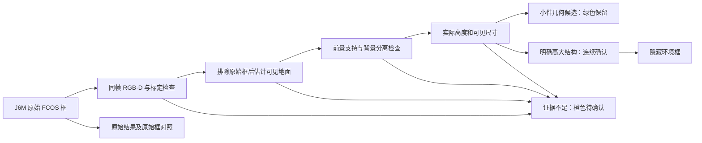
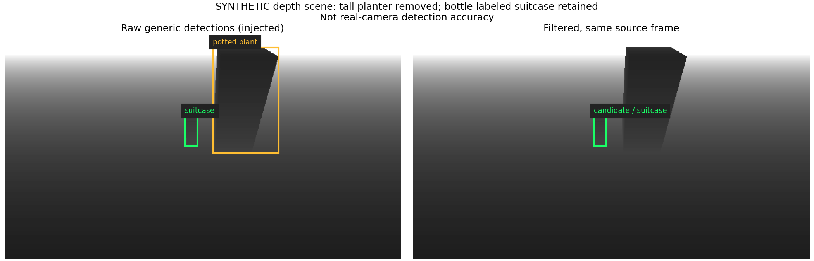

# J6M 垃圾误框：原因、优化与次日验收

本次交付是基于现有 J6M FCOS 模型的**地面小件观察筛选候选版**。模型权重未更换或训练。
对高大环境物增加几何筛选，对透明、稀疏深度和模糊证据保留待确认；不能据此宣称现场垃圾
识别精度已提高到某个数值。操作员所述“瓶子识别为行李箱”尚无对应的同帧 RGB-D 和原始张量，
本次没有虚构该实例的模型根因或现场误检率。

## 版本与交付状态

- 工作区：`/home/slam/robot_j6m_ws_navigation_20260907`。
- 新本地分支：`feature/litter-perception-optimization-20260908`。
- 基线：`99e8ac9abccae42c70e66b589ed309cdd6216bd8`；原导航分支保留此提交。
- 原双感知分支保留 `8c98737`，GNSS 分支保留 `d94480a`；未推送、合并或改动其他工作树。
- 新代码执行在 AGX：复用 J6M 已有推理结果和 AGX 上的 ZED 注册深度；没有新增跨机深度传输。
- 未部署 J6M。只读核对 `current` 仍为 `20260907_214928`。FCOS HBM SHA256 保持
  `1daacc7dfde181b65872c47f4fe5db84fd31f19d3ad56aa1fa1d902bb5ffd7fa`。
- 完整实车程序保持停止。主运动门/FOD 门均保留 false，未创建授权、发送初值、目标或速度。
- 同一工作区现留在新分支，本机构建产物供此版本使用；旧分支的源码和 Git 提交没有被覆盖。

## 全链路原因分析

| 环节 | 本次核对到的事实 | 对误框/漏检的影响与处理 |
|---|---|---|
| 输入/安装 | ZED 左目在 base_link `[0.62,-0.14,1.00] m`，向下 41°；使用已有确认安装参数 | 俯视、横躺、压扁、小尺寸及透明瓶与常见通用训练图像不同，存在分布差异；这是合理解释，尚非该错标实例的定量证明 |
| 前处理 | AGX 将 RGB 等比例缩放、右/下补黑至 896²，BGR→NV12；按 x/y 实际缩放还原源图坐标 | 没发现可直接证实瓶子→行李箱的通道/类别错位；保持既有前处理和坐标协议，不凭猜测修改归一化 |
| 模型任务 | 当前 FCOS 是 COCO 80 类；配置中 28=suitcase、39=bottle、58=potted plant | “检测到盆栽”和“把盆栽当垃圾”是两个判断。旧 Qt 直接画所有 FCOS 框，缺少地面垃圾候选筛选；通用类别不是垃圾属性 |
| 解码 | 当前调用 `decode_fcos_demo.py`：分类 sigmoid × centerness sigmoid，阈值 .2，逐类 NMS .6，最多100框 | 与旧实现等价的历史测试不能证明与此 HBM 的 HEAL 官方解码完全一致；缺同模型黄金输入/输出。暂不改 LTRB/stride/score 约定 |
| 标签过滤 | FCOS RGB-D 实际发布/绘图路径不调用原视觉后端的 CLIP 黑白名单 | 改另一个后端的语义配置未必影响这一路。按 suitcase/potted plant 硬删会删掉同标签的真实垃圾；新筛选不以类名或置信度作否决条件 |
| 深度 | 旧代码校验同光学帧、RGB/深度/内参时间差≤20 ms，前景聚类生成代表点 | “存在深度点”不等于“小件垃圾”。单个 Z×二维框宽高会把背景、透视、倾斜混入尺寸；新增直接从当前前景点计算几何 |
| 时序 | 旧原始跟踪 ID 按类别匹配；标签跳变可更换 ID | 新筛选的证据关联独立于类名与原始 ID，按严格一对一 IoU 关联；重叠歧义、消失、间隔超时均清除拒绝证据 |
| 显示/下游 | 旧图上所有通用检测均画框；正式垃圾/五材质后端仍独立存在 | Qt 默认显示筛选结果，支持全部原始框对照；原始观测 topic 保留。没有把此筛选接到自动拾取、TEB 或速度控制 |
| 性能 | 历史完整栈已有多框深度耗时/帧龄问题 | 新步骤限制采样、处理框数及启动下一项计算的时间预算。已有深度聚类在极多框场景仍可能超过 .35 s，不能宣称整条链性能已解决 |

FCOS 原作者[后处理实现](https://github.com/tianzhi0549/FCOS/blob/master/fcos_core/modeling/rpn/fcos/inference.py)
提供 centerness 和 NMS 的参考，但不能替代本 HBM 的厂家黄金对照。不同实现的阈值不能直接比较：
乘积 .2 对应其平方根约 .447；盲目改分数或抬阈值会改变召回。
透明/反光表面的双目深度困难也有专门研究，例如
[ClearDepth](https://arxiv.org/abs/2409.08926)。因此本版不把无效深度、平面样深度或背景穿透
当作“非垃圾”证据。

## 已实现的判定



1. 使用现有相机 TF 与安装标定核对，再对**当前帧**深度做有界采样。地面估计排除所有原始框，
   仅接受接近车体参考地面的平面：至少100点、至少65%支持、空间跨度足够、倾斜≤12°。
   没有可靠可见地面就保留全部框，不复用旧地面或旧图像。
2. 框内保留原始有效深度，提取地面以上连通支持。检查有效比例、前景占比、主成分支配比例、
   对框两侧背景的深度分离，以及两图像轴覆盖度；没有补洞、跨深度边界平滑或凭框中心一点外推整个物体。
3. 仅从可见前景点的5/95分位计算实际高度和尺寸。默认绿色条件：近地面、顶部≤0.45 m，
   水平可见跨度≤0.60 m。它表示“小件几何符合”，并不证明是应清扫垃圾。
4. 明确环境证据：顶部>0.70 m且可见高度跨度>0.50 m；或宽度>0.85 m且顶部>0.45 m。
   还要连续≥3个源帧、跨时长≥0.12 s才隐藏。几何阈值之间的区域保持待确认。
5. 相邻源帧间隔>0.25 s、目标消失、关联不唯一、证据不足或待发布帧过期，会中断拒绝确认。
   关联 IoU≥0.65，不依赖 FCOS 类别和原始 ID。不会把“固定不动”作为环境物判据。
6. 深度缺失/穿透、很薄的纸片、边缘截断、遮挡、相机标定不一致或计算超预算均保留橙框。
   新模块默认最多检查24个框，约20 ms为继续启动计算的软预算；当前单项计算和审计整理可能略超。

配置在 `src/application/autolabor_fod_vision/config/litter_filter.yaml`，启动时加载并严格检查取值。
默认范围按“地面常见小件垃圾”制定，**尚未用现场标注数据调参**。不应为减少框数不断收紧尺寸阈值。

“透明矩阵/滤波”的可用部分是深度有效性和前景支持掩码；图像透明度本身只改变显示，不能判断垃圾。
颜色过滤会误伤绿色包装，固定图像区域掩码会漏掉移动视角中的垃圾；二维长宽比会随横躺、透视、遮挡变化。
本版保留长宽比供审计，不作硬过滤。也没有按“静止物体”删除，否则静止垃圾同样会消失。

## 界面和数据接口

| 接口 | 内容 |
|---|---|
| `/perception/fcos/objects` | 完整原始框、原类名/ID/置信度和旧深度定位结果 |
| `/perception/fcos/litter_candidates` | 几何候选及待确认目标，使用已有消息定义；`motion_eligible=false` |
| `/perception/fcos/filter_audit` | 每个原始框的状态、原因、支持比例、尺寸、高度、连续确认数；会话、整数纳秒源时间、配置 SHA 与实现源码 SHA |
| `/fod/bpu_preview/image` | 筛选后图：绿色 `FLOOR`、橙色 `REVIEW`；原标签仅作参考 |
| `/perception/fcos/raw_preview` | 同源帧、全部原始框的对照图，按订阅需求生成 |
| `/perception/fcos/status` | 原链路耗时/帧龄，另加筛选耗时、候选/待确认/隐藏数量及配置 SHA |

Qt“BPU 预览”页新增“显示原始检测框（综合页同步切换）”。切换清掉旧显示缓存并拒收上一视图的
排队回调。实时切换会等下一帧，严格同帧对照请使用录包中的两个预览 topic 和相同源时间戳。
离开页面只取消图像订阅，FCOS RGB-D 伴随感知仍按原模式运行。
候选消息里的待确认目标可能没有有效三维位置，消费者仍须检查 `valid/calibrated/position_valid`；
`filter_audit` 才提供逐目标筛选状态，不能将 candidate topic 中每个条目理解为已确认垃圾。

## 本地验证与实际限制

验证记录保存在 `validation/litter_filter_20260908/`，随 Git 留存的选定证据见
[`validation/20260908/litter_filter/`](validation/20260908/litter_filter/)。

- 本机完整 Release 构建通过；134项视觉测试、21项BPU测试、52项Qt契约检查，共207项
  新鲜包测试零失败；视觉测试中的解释器入口另执行6个ROS消息发布场景。静态健康检查通过。
  静态输出所汇总的437项包含其他历史XML，不冒充本轮重跑全部437项；详细清单见同目录证据。
- 合成射线深度场景覆盖高大盆栽、错标行李箱的瓶子、横躺瓶、薄纸、透明深度缺失/穿透、
  背景墙、边缘截断、标签跳变、重叠关联、断流/过期、标定缺失、米/毫米深度和多框预算。
- 发布场景执行真实 `FcosRgbd.publish`、ROS 消息序列化和实际检测解释器的 CvBridge，
  使用内存消息/TF/时钟替身。没有运行 ROS master、真实相机、BPU 推理、Qt/Ogre 渲染或机器人。
- 系统用户目录 OpenCV 5 与现有 CvBridge 的类型常量不兼容，运行测试曾因此失败；实际节点使用
  既有 `fod_yolo` 解释器/OpenCV 4.10。发布测试现在明确用 launch 配置的同一解释器，不改系统依赖。
- 性能测试发现并修复新关联代码的逐对 Python 开销；100框阶段曾约290 ms，向量化后约21 ms。
  最终两框中位数8.89 ms/P95 9.12 ms，100框中位数20.80 ms/P95 21.36 ms。
  12/24/100框是重复 ROI 压力输入，不是独立物体数、真实检测帧率或精度。
- 原有深度聚类在100框压力输入仍约375 ms，超过原0.35 s帧龄上限；完整多模型导航负载下的
  输出频率和漏帧仍须实测。新增筛选不是对此历史瓶颈的性能保证。



**尚不能解决的情况：**同样大小的小盆栽、杯子或非垃圾摆件也可能符合小件几何；透明瓶的真实深度
无法仅靠此滤波恢复；高大物体在图像边缘截断时会保留；FCOS 原本完全没检出的纸屑/小垃圾不会被
后处理补出。过度遮挡、多对象合框、坡面或深度背景误配仍可能影响判断。没有现场标注集，不能宣称
“零漏检”“误检下降多少”或自动清扫验收通过。

若下一步仍要求显著提高小盆栽与垃圾的区分，应采集本安装角度下的瓶、袋、纸、压扁/透明目标，
连同盆栽、家具、线缆等困难负样本，训练“垃圾/非垃圾”专用检测或二级分类；按场景/录制段划分
训练与验收集，再做量化校准、浮点与 BPU 对照。当前只完成现有模型上的保守候选筛选。

## 次日操作员验收

程序目前停止。恢复设备供电后，在此工作区核对分支；无需重新部署 J6M。正常完整启动仍用统一入口：

```bash
cd /home/slam/robot_j6m_ws_navigation_20260907
git branch --show-current
./scripts/optimized.sh start --map-set \
  /home/slam/robot_j6m_ws_navigation_20260907/global_maps/map_sets/map_20260829_221335_gimp_cleaned </dev/null
```

本轮没有执行此启动命令。按既有流程由操作员在新会话设置真实初值；不要复用旧初值。
此感知识别对照不需要放行车辆运动。

1. “BPU 预览”页先勾选原始框，再取消勾选，确认同一批实物的显示变化；记录会话/配置 SHA。
2. 同时放置盆栽和瓶子，尤其复现“瓶子标签为 suitcase”。检查瓶子在绿色或橙色状态仍出现，
   高大盆栽仅在地面/深度证据充足且连续确认后隐藏。小盆栽无法可靠区分时保留是本版限制。
3. 检查横躺瓶、直立瓶、透明瓶、纸团、平纸/包装袋；改变距离、光照、遮挡和位置。
   任何“原始框有目标、筛选框没有目标”的情况都是需要复盘的过滤新增漏检。
4. 暂时遮挡目标或让其离开视野，再放回；不得复用旧拒绝状态。相机断流时，旧图应明确标为旧结果，
   raw/candidate 观测应无效且为空。
5. 记录完整场景段的候选/待确认/隐藏量、有效输出频率、源帧龄和 `geometry_budget`。
   不把“屏幕更干净”当作验收通过；无效/过期整帧也必须计入链路检查。

建议录制30秒有界样本（在本机执行；命令仅订阅感知数据）。两个预览同时订阅会额外生成对照图：

```bash
./scripts/optimized.sh run bash -c '
  source scripts/setup_env.sh
  mkdir -p validation/litter_acceptance
  rosbag record --lz4 --duration=30 --split --size=256 \
    -o validation/litter_acceptance/ab \
    /fod_camera/image_raw /fod/bpu_preview/image /perception/fcos/raw_preview \
    /perception/fcos/objects /perception/fcos/litter_candidates \
    /perception/fcos/filter_audit /perception/fcos/status
'
```

首轮录包用于同帧框、漏检及原因对照；若要重新计算几何，另录对应注册深度、CameraInfo、TF，
注意深度数据体积。不要把只含框的包声称可重新跑 RGB-D 几何。

离线评估脚本不连接实车。人工对选定源帧**完整标注所有垃圾**，包括原模型没框到的目标；
类名不参与匹配。标签 JSON 格式如下（时间/坐标须替换成真实标注，空列表只用于确认无垃圾的帧）：

```json
{"exhaustive_trash_labels": true, "frames": [
  {"session_id": "取自同帧审计", "source_stamp_ns": 1234567890000000000,
   "trash_boxes": [[100, 120, 145, 210]]}
]}
```

```bash
./scripts/optimized.sh run bash -c '
  source scripts/setup_env.sh
  python3 scripts/evaluate_litter_filter.py \
    --audit validation/litter_acceptance/实际录包.bag \
    --labels validation/litter_acceptance/人工标注.json \
    --output validation/litter_acceptance/新的评估报告.json
'
```

工具计算原始/筛选的 TP、FP、FN、precision/recall，以及过滤新增 FN；一对一 IoU≥0.5，重复框
不能充当多个真目标。漏配帧、重复帧、混合配置/实现和非完整标注会报错，不能静默补成零。
计数单位是标注帧内目标，不是独立垃圾总数或 mAP。分片录包请将同一批审计先合并为 JSONL，
再提供全部标注帧；不要忽略没有配对结果的片段。

首轮建议验收要求：目标垃圾均能在原始/筛选对照中解释；本场景过滤新增 FN 为0；有明确几何证据的
高大环境框减少；不确定目标保留；源帧新鲜度与有效频率不出现不可接受退化。
这些是待现场验证的判据，不是本次已测得的现场结果。

## 停止与回退

正常停止：`./scripts/optimized.sh stop </dev/null`。只回到原始显示可直接勾选原始框，无需改运动配置。
若要回到之前导航版本，在完整停止、工作树干净且本轮提交已保存后：

```bash
git switch feature/navigation-optimization-20260907
./scripts/optimized.sh build
```

切回新版本同样先停止、检查改动、切分支、重新构建。两个分支共享此目录的 build/devel，
所以切源码不能代替构建；J6M 本次未变，无需回滚板端 release。没有复制任何运动授权。
