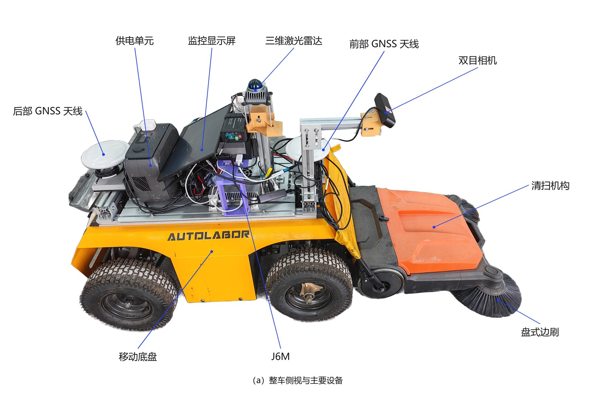
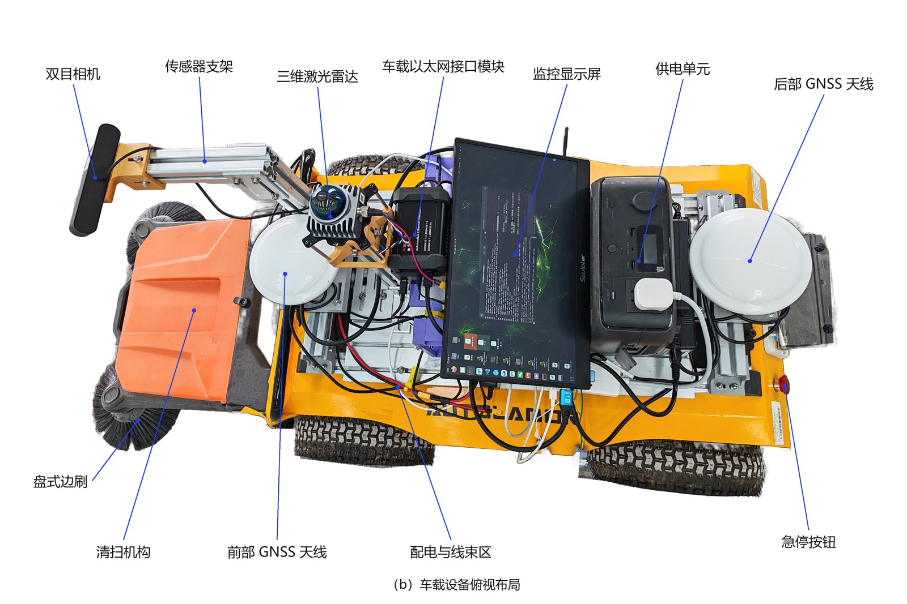
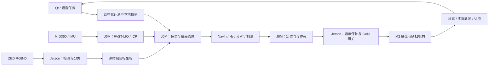
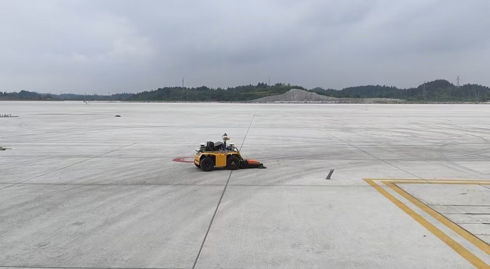
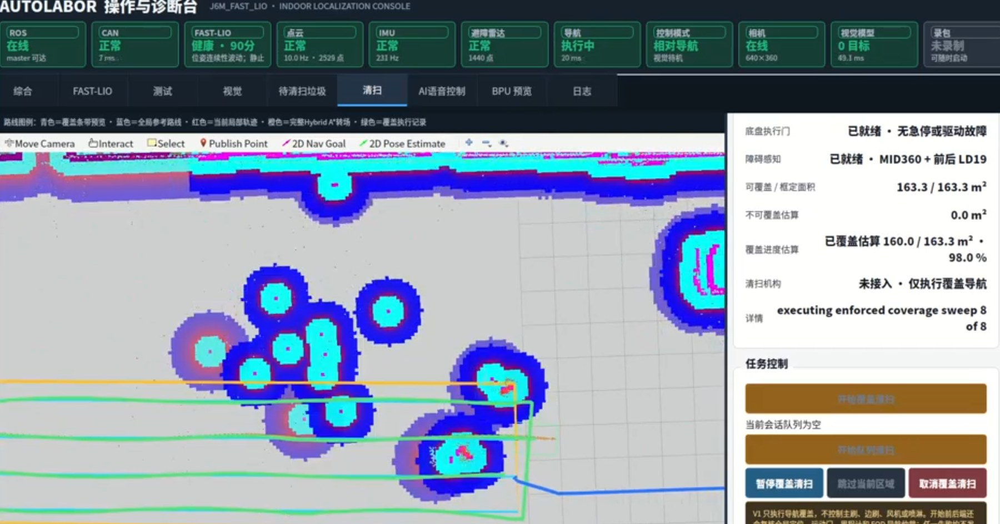
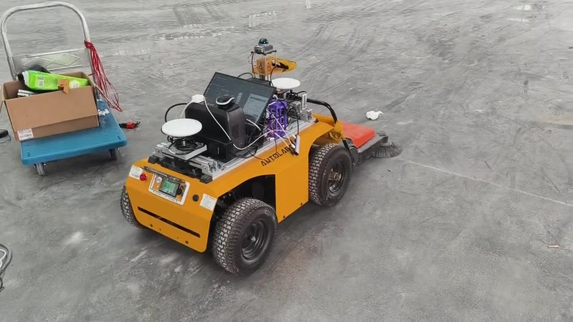
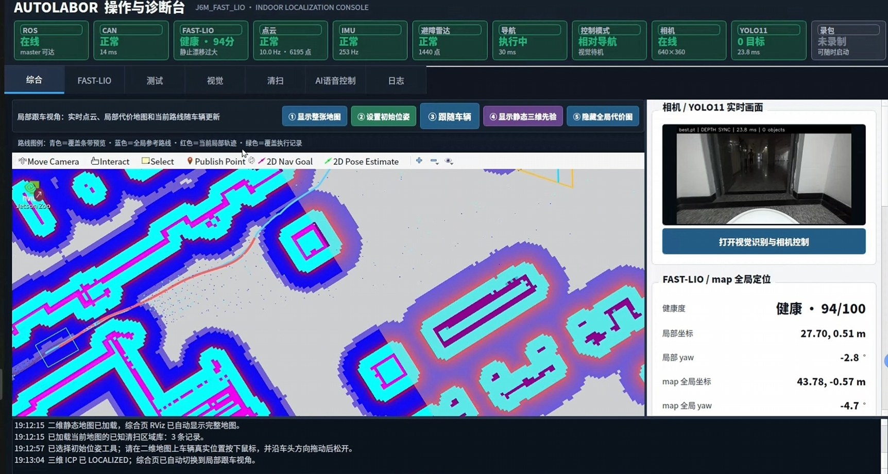

# 净途智行：从自主导航到刷扫收集

[返回项目 README](../README.md) · [在线作品集与视频播放](https://doribelove.github.io/projects/#autolabor)

本页整理“揭榜挂帅”地平线挑战杯项目的 2026 年 9 月实战材料。
系统以 Autolabor M2 阿克曼底盘为载体，集成 J6M、Jetson AGX Orin、MID360、前后 LD19、
ZED 2 和刷扫收集机构，完成地图与定位、点到点导航、区域覆盖、垃圾感知及人机交互的工程集成。

## 整车与设备布局

整车侧视：计算平台、三维激光雷达、双目相机、双天线 GNSS 与前部刷扫机构。

俯视布局：传感器、计算与供电设备在 M2 平台上的安装关系。

## 双机分工与任务流程

| 环节 | 实现与工程关注点 |
| --- | --- |
| 定位与地图 | J6M 运行 FAST-LIO 与已知地图 ICP；三维定位图与二维通行图共享坐标和地图身份。竞赛报告另记录双天线 GNSS 可选定位路径。 |
| 导航与区域覆盖 | 普通导航及区域首线入场使用 Navfn；区域内转场使用考虑车体约束的 Hybrid A*，以 TEB 执行局部轨迹；按实际轨迹更新覆盖进度。 |
| 垃圾感知 | Jetson 处理 YOLO11-GAM 检测、五类材质分类及 RGB-D；以源帧时间和对应位姿把目标转换到地图坐标。 |
| 交互与任务 | Qt/RViz、语音与结构化任务接口连接计划、校验、执行回执和任务终态，支持点到点与区域任务。 |
| 运动执行 | J6M 完成定位门和控制仲裁；Jetson 执行最终速度保护，经 USB-CAN 驱动 M2 底盘。 |

双机结构、通信和控制链的细节见[架构文档](ARCHITECTURE.md)。
SDERI 是独立研究成果，未用于此双机部署和覆盖导航；论文对照实验也与下面的竞赛记录分别评价。

## 机场导航覆盖

机场开阔场地中的 M2 原型。该组演示采用 FAST-LIO 定位与 `navigation_20260907` 入口。

| 指标 | 记录 | 适用范围 |
| --- | --- | --- |
| 可覆盖区域 | 163.3 m² | Qt 选定区域 |
| 实际轨迹覆盖面积 | 160.0 m² | 按轨迹扫掠区域的并集统计 |
| 覆盖进度 | 98.0% | 最后可见统计，显示第 8/8 段 |
| 完整路线时间 | 约 140.3 s | 技术报告 v7 对正常倍速视频的复核：约 01:02.500 入区至 03:22.788 路线完成 |

截图明确标注“清扫机构：未接入，仅执行覆盖导航”。因此本组数值描述导航覆盖，
不代表垃圾清除率、合格清洁面积或机械清扫效率；下节以另一段视频展示已安装机构的实际作业。

## 实物刷扫与收集演示

[播放 / 下载 MP4](media/autolabor-demo.mp4) · [在在线作品集中播放](https://doribelove.github.io/projects/#autolabor)

20.5 秒现场视频展示装有刷扫机构的 M2 随车作业过程，用于说明边刷、滚刷与收集通道的实际集成。
发布版保持原始播放速度，转为适合浏览器的 H.264 视频并移除音轨；它与机场覆盖统计来自不同记录。

## 操作界面

Qt 将底盘、传感器、定位、地图、视觉与任务状态集中呈现，支持地图交互与任务反馈。
竞赛材料中的 100 条文本样例属于离线结构化计划校验；这组结果不等同于语音转写正确率或实车任务完成率。

## 材料与验证范围

本页依据项目所有者提供的《技术报告_提交v7》、2026 年 9 月补充照片及原始实物视频整理。
机场计时采用报告第 4.3.1 节的正常倍速复核结果；图片原文件名中的“158 秒”不作为计时依据。
报告中的 360 × 180 m 厂库地图为合成地图，用于大规模地图生成与导入验证，并非实车已测绘的作业面积。
固定初值 60 次定位实验评价相对重复一致性，不代表外部真值下的绝对定位精度。

精选媒体经过尺寸或编码优化，保留画面内容；未纳入报名表、联系方式、整份内部报告或多 GB 原始视频归档。
媒体来源及编码信息见[素材说明](media/README.md)。
